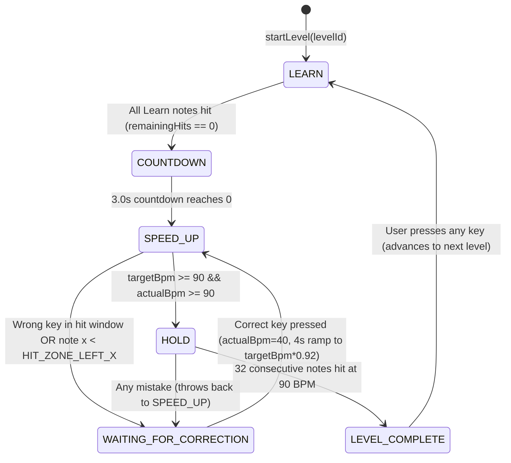

# System Design and Detailed Specification: No-Nonsense Sight-Reading

> **Target Audience**: Autonomous Engineering Agents (e.g., Gemini 3.8 Flash) and Software Engineers.
> **Purpose**: This document is the complete, unambiguous architectural blueprint, mathematical model, module specification, testing strategy, and phased implementation plan for **No-Nonsense Sight-Reading** (derived from [HIGH_LEVEL_SPEC.md](file:///home/benjaminkiesl/code/no_nonsense_sight_reading/HIGH_LEVEL_SPEC.md)). Every algorithm, data structure, coordinate calculation, and edge case is specified explicitly so each phase can be implemented and verified independently without guesswork.

---

## Table of Contents

1. [Architecture & Tech Stack](#1-architecture--tech-stack)
2. [Domain Model & Musical Representation](#2-domain-model--musical-representation)
3. [Curriculum & Level Graph Specification](#3-curriculum--level-graph-specification)
4. [Deliberate Practice Engine: Mathematical Models](#4-deliberate-practice-engine-mathematical-models)
5. [Game Loop, Physics & State Machine](#5-game-loop-physics--state-machine)
6. [Input Subsystem (MIDI, Keyboard, On-Screen Piano)](#6-input-subsystem-midi-keyboard-on-screen-piano)
7. [Rendering & Visual Design Specification](#7-rendering--visual-design-specification)
8. [Persistence & State Management](#8-persistence--state-management)
9. [Comprehensive Testing Strategy](#9-comprehensive-testing-strategy)
10. [Phased Implementation Plan for Execution Agents](#10-phased-implementation-plan-for-execution-agents)

---

## 1. Architecture & Tech Stack

### 1.1 Technology Choices
- **Language**: TypeScript 5.x (`strict: true`, `noUncheckedIndexedAccess: true`).
- **UI Framework**: React 18+ with Vite as the bundler.
- **Music Engraving & Animation**: Custom **HTML5 2D Canvas** for the scrolling Grand Staff (`StaffCanvas`) and custom **Inline SVG** for the Level Graph (`LevelGraph`) and On-Screen Piano (`PianoKeyboard`).
  - *Why Custom HTML5 2D Canvas instead of VexFlow/OSMD for the scrolling staff?* VexFlow is designed for static page layout; re-laying out staves at 60–120 FPS causes GC pauses and jitter. A custom 2D Canvas renderer drawing staff lines, Bravura/SVG clef paths, noteheads, stems, accidentals, and ledger lines at exact floating-point coordinates guarantees silky-smooth 60/120 FPS scrolling and exact hit-zone geometry.
- **State Management**:
  - **High-Frequency Loop State (60–120 Hz)**: Pure TypeScript mutable engine class (`SightReadingEngine`) ticked via `requestAnimationFrame`. Never triggers React re-renders on every frame.
  - **UI / Reactive State**: Lightweight Zustand store (`useAppStore`) synchronized only on discrete events (note hit, note miss, phase change, level change, MIDI connection change, key press highlight).
- **Styling**: Vanilla CSS with CSS Custom Properties (variables) matching the exact palette in the spec. No heavy UI component libraries.
- **Mobile Packaging (Future-Ready)**: Capacitor (`@capacitor/core`) compatibility built in from Day 1 via responsive viewport units, touch event handlers (`onPointerDown`/`onPointerUp`), and a pluggable `MidiAdapter` interface (Web MIDI API on desktop/Android web; native BLE/USB MIDI plugin bridge on iOS/Android Capacitor).
- **Audio**: Strictly silent visual-only trainer (zero audio latency/overhead; users hear their own connected digital/acoustic instrument).
- **Testing**:
  - **Vitest** for unit and property-based/simulation tests of pure TypeScript modules (`music`, `curriculum`, `engine`, `input`).
  - **React Testing Library + jsdom** for component and integration tests.
  - **Playwright** for end-to-end (E2E) browser verification.

### 1.2 Directory Structure
```text
no_nonsense_sight_reading/
├── package.json
├── tsconfig.json
├── vite.config.ts
├── index.html
├── src/
│   ├── main.tsx
│   ├── App.tsx
│   ├── styles/
│   │   ├── tokens.css           # Exact color variables, typography, layout variables
│   │   └── app.css              # Global & component styles
│   ├── types/
│   │   ├── music.ts             # Pitch, NoteEvent, Clef, KeySignature, StaffPosition
│   │   ├── curriculum.ts        # LevelSpec, LevelNode, LevelStatus, ClefLane
│   │   └── engine.ts            # Phase, ActiveNote, EngineSnapshot, EngineConfig
│   ├── music/
│   │   ├── pitch.ts             # MIDI <-> Pitch conversions, enharmonics, staff steps
│   │   ├── scales.ts            # Key signatures, scale pitch sets, accidental lookup
│   │   └── notation.ts          # Ledger lines, stem direction, notehead geometry
│   ├── curriculum/
│   │   ├── levels.ts            # Complete level definitions & DAG builder
│   │   └── graph.ts             # Graph traversal, ancestor completion, node layout
│   ├── engine/
│   │   ├── distribution.ts      # Adaptive note probability distribution & Markov bigram boost
│   │   ├── speed.ts             # Continuous BPM physics, acceleration, failure slowdown
│   │   ├── learnQueue.ts        # Learn phase note scheduler (<=24 notes constraint)
│   │   └── engine.ts            # Main SightReadingEngine state machine & frame loop
│   ├── input/
│   │   ├── keyboardMapper.ts    # Laptop keyboard (c-h, Shift=#, Cmd/Alt=b, octave adapt)
│   │   ├── midiManager.ts       # Web MIDI API wrapper & device hot-plug tracker
│   │   └── inputRouter.ts       # Unified input dispatcher (MIDI + Keyboard + On-Screen)
│   ├── store/
│   │   └── useAppStore.ts       # Zustand store + localStorage persistence
│   └── components/
│       ├── Header.tsx           # Title + MIDI status indicator
│       ├── GrandStaffCanvas.tsx # 60fps HTML5 Canvas renderer for grand staff & notes
│       ├── ProgressBar.tsx      # Discrete-step Learn / Speed Up / Hold progress bar
│       ├── PianoKeyboard.tsx    # 4-octave interactive SVG piano (C2 to B5 + C6)
│       ├── LevelGraph.tsx       # 3-lane vertical DAG with custom staff/interval icons
│       └── CelebrationOverlay.tsx # Level completion celebration & "Press any key" prompt
└── tests/
    ├── music/
    ├── curriculum/
    ├── engine/
    ├── input/
    └── ui/
```

---

## 2. Domain Model & Musical Representation

To support single notes now and seamlessly extend to **intervals, chords, and real sheet music (MusicXML/MIDI import)** later, all musical entities are modeled as a polyphonic-ready hierarchy.

### 2.1 Core Types (`src/types/music.ts`)

```typescript
export type LetterName = 'C' | 'D' | 'E' | 'F' | 'G' | 'A' | 'B';

/**
 * -1 = Flat (b), 0 = Natural, +1 = Sharp (#)
 */
export type Accidental = -1 | 0 | 1;

export type Clef = 'treble' | 'bass';

export type Octave = 1 | 2 | 3 | 4 | 5 | 6 | 7;

/**
 * Canonical spelled pitch.
 * Preserves enharmonic spelling (e.g. F#4 vs Gb4 have the same midiNumber 66,
 * but sit on different staff steps and require different keyboard shortcuts).
 */
export interface SpelledPitch {
  readonly letter: LetterName;
  readonly accidental: Accidental;
  readonly octave: Octave;
  /** Standard MIDI note number: C4 (Middle C) = 60, A4 = 69 */
  readonly midi: number;
  /** Canonical ID string, e.g., "C4", "F#4", "Bb3" */
  readonly id: string;
  /**
   * Diatonic step relative to C0 (C0 = 0, D0 = 1, ..., C4 = 28, D4 = 29, etc.)
   * Used for O(1) staff vertical position and ledger line calculation:
   * diatonicStep = octave * 7 + LETTER_INDEX[letter]
   */
  readonly diatonicStep: number;
}

/**
 * A NoteTarget on a specific clef.
 * Note that the same pitch (e.g. C4, midi 60) can be written on the treble clef
 * or on the bass clef. They are distinct sight-reading targets!
 */
export interface StaffNoteTarget {
  /** Unique target key: `${clef}:${pitch.id}`, e.g. "treble:C4" or "bass:C4" */
  readonly targetId: string;
  readonly clef: Clef;
  readonly pitch: SpelledPitch;
}

/**
 * Future-proof container: A MusicalEvent can hold 1 note (Single Note),
 * 2 notes (Interval), or 3+ notes (Chord/Two-hand voicing).
 * In v1, `notes` always has length 1.
 */
export interface MusicalEvent {
  readonly eventId: string;
  readonly notes: readonly StaffNoteTarget[];
  /** Quarter note = 1.0, Half = 2.0, Eighth = 0.5. Always 1.0 in v1. */
  readonly durationBeats: number;
}
```

### 2.2 Pitch & Diatonic Math (`src/music/pitch.ts`)

1. **Letter Indices & Semitone Offsets**:
   - `LETTER_INDEX`: `{ C: 0, D: 1, E: 2, F: 3, G: 4, A: 5, B: 6 }`
   - `LETTER_SEMITONE`: `{ C: 0, D: 2, E: 4, F: 5, G: 7, A: 9, B: 11 }`
2. **MIDI Calculation**:
   $$\text{midi} = (\text{octave} + 1) \times 12 + \text{LETTER\_SEMITONE}[\text{letter}] + \text{accidental}$$
   - Verification: `C4` $\rightarrow (4 + 1) \times 12 + 0 + 0 = 60$.
   - `C2` $\rightarrow (2 + 1) \times 12 + 0 = 36$.
   - `C6` $\rightarrow (6 + 1) \times 12 + 0 = 84$.
3. **Staff Step Coordinate System**:
   - Every line and space on a 5-line staff is 1 diatonic step (`0.5 * staffLineSpacing` in pixels).
   - Define `staffStepOffset(pitch: SpelledPitch, clef: Clef): number` as the number of diatonic steps **above the bottom line** of that clef's 5-line staff:
     - **Treble Clef** bottom line is `E4` (`diatonicStep = 4 * 7 + 2 = 30`).
       $$\text{stepOffset}_{\text{treble}}(\text{pitch}) = \text{pitch.diatonicStep} - 30$$
       - `E4` = 0 (bottom line), `F4` = 1 (first space), `F5` = 8 (top line), `C4` (Middle C) = -2 (1 ledger line below), `A3` = -4 (2 ledger lines below), `A5` = 10 (1 ledger line above), `C6` = 12 (2 ledger lines above).
     - **Bass Clef** bottom line is `G2` (`diatonicStep = 2 * 7 + 4 = 18`).
       $$\text{stepOffset}_{\text{bass}}(\text{pitch}) = \text{pitch.diatonicStep} - 18$$
       - `G2` = 0 (bottom line), `A3` = 8 (top line), `C4` (Middle C) = 10 (1 ledger line above), `E2` = -2 (1 ledger line below), `C2` = -4 (2 ledger lines below).
4. **Ledger Line Calculation (`getLedgerLines(stepOffset: number): number[]`)**:
   - Staff lines sit at even `stepOffset` values: `0, 2, 4, 6, 8`.
   - If `stepOffset <= -2`, ledger lines are drawn at every even integer $k$ where $\text{stepOffset} \le k \le -2$ (e.g., for `A3` in treble, `stepOffset = -4`, ledger lines at `-2` and `-4`; for `B3` in treble, `stepOffset = -3`, ledger line at `-2`).
   - If `stepOffset >= 10`, ledger lines are drawn at every even integer $k$ where $10 \le k \le \text{stepOffset}$ (e.g., for `C6` in treble, `stepOffset = 12`, ledger lines at `10` and `12`).
5. **Stem Direction Rule**:
   - Middle line of any staff is `stepOffset === 4` (`B4` in treble, `D3` in bass).
   - If `stepOffset >= 4`, stem points **down** (attached to left side of notehead).
   - If `stepOffset < 4`, stem points **up** (attached to right side of notehead).

---

## 3. Curriculum & Level Graph Specification

### 3.1 Level Structure & Progression Rules
Per the specification and user clarification:
- There are three vertical lanes in the Level Graph:
  1. **Left Lane (`treble`)**: Treble clef only.
  2. **Middle Lane (`both`)**: Grand staff combining the treble and bass notes from the corresponding tier.
  3. **Right Lane (`bass`)**: Bass clef only.
- Each single-clef lane starts with **3 notes** (`C, D, E` of the inner octaves) and adds **2 new notes per level**.
- **Treble Clef Expansion (9 Natural Levels)**:
  - Starts at `C4, D4, E4` (Middle C, D, E).
  - Expands upwards, bringing in the lower `B3` and `A3` below Middle C early (in Tier 3 once the core 5-finger `C4–G4` position is established), then climbing continuously up to `C6`.
- **Bass Clef Expansion (9 Natural Levels)**:
  - Starts at `C3, D3, E3`.
  - Climbs up to `C4` (Middle C) first, then expands downwards step-by-step down to `C2`.
- **Combined (`both`) Levels**:
  - At each Tier $k$, `both-k` is the exact union of `treble-k`'s note pool and `bass-k`'s note pool.
  - Its new notes (`newNotes`) are the union of `treble-k.newNotes` and `bass-k.newNotes` (which is $2 + 2 = 4$ new notes in Tiers $\ge 2$, or $3 + 3 = 6$ notes in Tier 1, keeping the Learn phase well under the 24-note ceiling!).
- **Scale / Key Signature Levels (Tiers 10–13)**:
  - Once the full natural range (`A3–C6` in Treble, `C2–C4` in Bass) is mastered in Tier 9, Tiers 10–13 introduce the most common sharp and flat key signatures in piano repertoire:
    - **Tier 10**: **G Major / E Minor** (1 Sharp: `F#` replacing `F` across all octaves; `F#` notes are the `newNotes`).
    - **Tier 11**: **F Major / D Minor** (1 Flat: `Bb` replacing `B` across all octaves; `Bb` notes are the `newNotes`).
    - **Tier 12**: **D Major / B Minor** (2 Sharps: `F#`, `C#`; `C#` notes are the `newNotes`, `F#` from previous levels).
    - **Tier 13**: **Bb Major / G Minor** (2 Flats: `Bb`, `Eb`; `Eb` notes are the `newNotes`, `Bb` from previous levels).
  - *Note on Accidental Display*: In v1, accidentals (`♯` / `♭`) are rendered explicitly in front of the notehead AND the key signature is displayed at the left of the staff so the user practices reading both key context and altered pitches clearly.

### 3.2 Complete Curriculum Table (`src/curriculum/levels.ts`)

| Tier | Treble Level (`treble-k`) | Bass Level (`bass-k`) | Combined Level (`both-k`) |
| :--- | :--- | :--- | :--- |
| **1** | **T1**: `C4, D4, E4` *(New: C4, D4, E4)* | **B1**: `C3, D3, E3` *(New: C3, D3, E3)* | **M1**: T1 $\cup$ B1 |
| **2** | **T2**: `C4..G4` *(New: F4, G4)* | **B2**: `C3..G3` *(New: F3, G3)* | **M2**: T2 $\cup$ B2 |
| **3** | **T3**: `A3..G4` *(New: B3, A3)* | **B3**: `C3..B3` *(New: A3, B3)* | **M3**: T3 $\cup$ B3 |
| **4** | **T4**: `A3..B4` *(New: A4, B4)* | **B4**: `B2..C4` *(New: C4, B2)* | **M4**: T4 $\cup$ B4 |
| **5** | **T5**: `A3..D5` *(New: C5, D5)* | **B5**: `G2..C4` *(New: A2, G2)* | **M5**: T5 $\cup$ B5 |
| **6** | **T6**: `A3..F5` *(New: E5, F5)* | **B6**: `E2..C4` *(New: F2, E2)* | **M6**: T6 $\cup$ B6 |
| **7** | **T7**: `A3..A5` *(New: G5, A5)* | **B7**: `C2..C4` *(New: D2, C2)* | **M7**: T7 $\cup$ B7 |
| **8** | **T8**: `A3..C6` *(New: B5, C6)* | **B8**: `C2..D4` *(New: D4, E4)* | **M8**: T8 $\cup$ B8 |
| **9** | **T9 (G Maj / E min)**: `A3..C6` w/ `F#` *(New: F#4, F#5)* | **B9 (G Maj / E min)**: `C2..E4` w/ `F#` *(New: F#2, F#3)* | **M9**: T9 $\cup$ B9 |
| **10** | **T10 (F Maj / D min)**: `A3..C6` w/ `Bb` *(New: Bb3, Bb4, Bb5)* | **B10 (F Maj / D min)**: `C2..E4` w/ `Bb` *(New: Bb2, Bb3)* | **M10**: T10 $\cup$ B10 |
| **11** | **T11 (D Maj / B min)**: `A3..C6` w/ `F#, C#` *(New: C#4, C#5, C#6)* | **B11 (D Maj / B min)**: `C2..E4` w/ `F#, C#` *(New: C#2, C#3, C#4)* | **M11**: T11 $\cup$ B11 |
| **12** | **T12 (Bb Maj / G min)**: `A3..C6` w/ `Bb, Eb` *(New: Eb4, Eb5)* | **B12 (Bb Maj / G min)**: `C2..E4` w/ `Bb, Eb` *(New: Eb2, Eb3, Eb4)* | **M12**: T12 $\cup$ B12 |

*(Note: In Bass Tier 8, adding `D4, E4` keeps the 2-notes-per-level symmetry with Treble Tier 8 (`B5, C6`) so every single tier 1–8 adds exactly 2 notes per single-clef level!)*

### 3.3 Directed Acyclic Graph (DAG) Edges & Transitive Completion
For every Tier $k \in \{1 \dots 12\}$:
- **Intra-lane edges**:
  - If $k < 12$: `treble-k` $\rightarrow$ `treble-(k+1)`
  - If $k < 12$: `bass-k` $\rightarrow$ `bass-(k+1)`
  - If $k < 12$: `both-k` $\rightarrow$ `both-(k+1)`
- **Cross-lane edges (into "both")**:
  - `treble-k` $\rightarrow$ `both-k`
  - `bass-k` $\rightarrow$ `both-k`

**Transitive Completion Rule ("Superset Completion")**:
> *"When a level is finished successfully, all levels that have a path to that level in the graph will also be highlighted as finished (because the finished one is a superset of those)."*

- Formally, let $G = (V, E)$ be the level graph.
- When level $v \in V$ is marked directly completed (`completedLevelIds.add(v)`), the set of **all finished levels** is the backwards reachability closure (all ancestors of any directly completed node):
  $$\text{Finished}(S) = \{ u \in V \mid \exists v \in S \text{ such that } u = v \text{ or there is a directed path } u \leadsto v \text{ in } G \}$$
- Example: If a user clicks and completes `both-3`, then `both-3`, `both-2`, `both-1`, `treble-3`, `treble-2`, `treble-1`, `bass-3`, `bass-2`, and `bass-1` all have directed paths to `both-3` and are automatically marked finished!
- Users can click **any** node in the Level Graph at any time to switch to that level (so experienced players can jump straight to a higher level and auto-complete its prerequisites upon finishing it).
- **Default Next Level Order**: When a user finishes a level and presses any key to continue, `getNextRecommendedLevel(currentLevelId, finishedSet)` selects:
  1. If `treble-k` was just finished and `bass-k` is not finished $\rightarrow$ `bass-k`.
  2. If `bass-k` was just finished and `treble-k` is finished $\rightarrow$ `both-k` (else `treble-k`).
  3. If `both-k` was just finished $\rightarrow$ `treble-(k+1)` (if $k < 12$, else stays on `both-12`).

---

## 4. Deliberate Practice Engine: Mathematical Models

This section resolves all scientific and mathematical questions in the specification with deterministic, well-bounded formulas.

### 4.1 Learn Phase Scheduling (`src/engine/learnQueue.ts`)
Requirements from spec:
1. Notes are shown statically inside the hit zone, one at a time.
2. Each **new note** (`N_new`, notes introduced in the current level) must be hit **correctly on the first attempt** at least **5 times**.
3. New notes from the **previous two levels** in the same lane (`N_prev`, introduced in $k-1$ and $k-2$) are interleaved in between, and each must be hit correctly on the first attempt at least **1 time**.
4. Overall, avoid having more than **24 notes** in the Learn phase if possible.

**Exact Algorithm (`LearnSessionManager`)**:
- Let $N_{\text{new}}$ be the array of new `StaffNoteTarget`s in the current level.
  - For single-clef levels: $|N_{\text{new}}| = 3$ (Tier 1) or $2$ (Tiers 2–12).
  - For combined (`both`) levels: $|N_{\text{new}}| = 6$ (Tier 1) or $4$ (Tiers 2–12).
- Let $N_{\text{prev}}$ be the new notes from levels $k-1$ and $k-2$ in the same lane (up to 4 notes for single-clef, up to 8 for `both`).
- **Required First-Try Correct Counts (`requiredHits`)**:
  - To satisfy the $\le 24$ total initial notes constraint while honoring "at least 5 times" for standard levels:
    - If $|N_{\text{new}}| \le 3$ (all single-clef levels): each $n \in N_{\text{new}}$ requires **5** first-try hits ($2 \times 5 = 10$ or $3 \times 5 = 15$ notes). Each $p \in N_{\text{prev}}$ requires **1** first-try hit (up to 4 notes). Total initial notes $= 10 + 4 = 14 \le 24$.
    - If $|N_{\text{new}}| > 3$ (combined `both` levels where 4 or 6 notes are combined): if all 4 required 5 hits + 8 review notes, that would be $28 > 24$. Therefore, for `both` levels, if a note in $N_{\text{new}}$ belongs to a single-clef level (`treble-k` or `bass-k`) that is *already finished*, it requires **3** first-try hits; otherwise we cap `requiredHits` per note at $\min(5, \lfloor (24 - |N_{\text{prev}}|) / |N_{\text{new}}| \rfloor)$ (which is $\ge 4$) and sample up to 4 review notes from $N_{\text{prev}}$ (1 hit each), guaranteeing total initial prompts $\le 24$.
- **Next Note Selection in Learn Phase**:
  - Maintain `remainingHits: Map<targetId, number>`.
  - On each step, filter `candidates = [ ...N_new, ...N_prev ].filter(n => remainingHits.get(n.targetId) > 0)`.
  - To prevent immediate repetition when $|candidates| > 1$, exclude the `lastShownTargetId` from selection unless only 1 unique `targetId` remains with `remainingHits > 0`.
  - Select from eligible candidates with weight proportional to `remainingHits.get(n.targetId)`.
- **First-Attempt Tracking**:
  - When a note is displayed in Learn phase, `failedOnCurrentPrompt = false`.
  - If the user presses the **wrong** key:
    - `failedOnCurrentPrompt = true`.
    - The note turns `vibrant-coral` (`#ee6055`) and **stays in the hit zone**.
    - Because `failedOnCurrentPrompt` is now `true`, when the user subsequently presses the **correct** key to clear it, `remainingHits[targetId]` is ** NOT decremented**! They still owe a clean first-attempt hit on that note later in the Learn phase.
    - Furthermore, that mistake immediately feeds into the **Adaptive Note Distribution** (Section 4.2) so the note starts the Speed Up phase boosted.
  - If the user presses the **correct** key on the first attempt (`failedOnCurrentPrompt === false`):
    - `remainingHits[targetId]` is decremented by 1.
    - The note flashes `emerald` (`#60d394`) and advances to the next Learn note.
  - When all entries in `remainingHits` reach 0, the Learn phase completes and transitions into the **3-2-1 Countdown** for the Speed Up phase.

---

### 4.2 Adaptive Note Distribution & Bigram (Predecessor) Model (`src/engine/distribution.ts`)

The spec asks a key architectural question:
> *"There will be a question of how we model mistakes in general: will we change the distribution AND statically queue in more of that note, or will we only handle this through the distribution and its modifications (which would be elegant if we have a good model for that). Also, notes that are new in a level will have a significantly higher likelihood of showing up in that level. In case of failures, it will make sense to also change the distribution of the note before the failure, because that one might actually have caused the failure, even if it was correct, by slowing down the user and/or demanding more attention."*

**Resolution**: We solve this purely through an **Exponentially-Decaying Weighted Distribution coupled with a First-Order Markov Transition (Bigram) Boost Matrix**, plus an anti-repeat cooldown. This eliminates brittle static queues while mathematically guaranteeing that failed notes—and the transition from the note *preceding* the failure—appear frequently right after a mistake and decay smoothly back to the baseline distribution over time.

#### Mathematical Formulation
Let $V = \{n_1, n_2, \dots, n_M\}$ be the active note pool for the current level.

1. **Baseline Weight $B(n_i)$ (New-Note Bias)**:
   - Every previously learned note $n_i \notin N_{\text{new}}$ has baseline weight:
     $$B(n_i) = 1.0$$
   - Every new note $n_i \in N_{\text{new}}$ in the current level has a permanently elevated baseline weight for the duration of this level:
     $$B(n_i) = 2.5$$
     *(New notes are $2.5\times$ more likely than old notes at baseline).*

2. **Dynamic Error Urgency $U(n_i)$ (Unigram Failure Boost)**:
   - Initialized to $U(n_i) = 0$ at level start.
   - Whenever note $n_{\text{fail}}$ is missed (or hit wrong):
     $$U(n_{\text{fail}}) \leftarrow \min\left(U_{\max}, \, U(n_{\text{fail}}) + \Delta_{\text{fail}}\right)$$
     where $\Delta_{\text{fail}} = 6.0$ and $U_{\max} = 18.0$.
   - Whenever the note **immediately preceding** the failed note was $n_{\text{prev}}$ (even if $n_{\text{prev}}$ was hit correctly):
     $$U(n_{\text{prev}}) \leftarrow \min\left(U_{\max}, \, U(n_{\text{prev}}) + \Delta_{\text{prev}}\right)$$
     where $\Delta_{\text{prev}} = 2.5$.

3. **First-Order Markov Transition Boost $T(n_{\text{prev}}, n_{\text{fail}})$ (Bigram Failure Boost)**:
   - Often a user misses $n_{\text{fail}}$ specifically because moving their eye or hand *from* $n_{\text{prev}}$ *to* $n_{\text{fail}}$ was difficult.
   - We maintain a transition boost matrix $T(a, b) \ge 0$, initialized to 0.
   - On failure of $n_{\text{fail}}$ preceded by $n_{\text{prev}}$:
     $$T(n_{\text{prev}}, n_{\text{fail}}) \leftarrow \min\left(10.0, \, T(n_{\text{prev}}, n_{\text{fail}}) + 4.5\right)$$
   - When the most recently spawned note is $n_{\text{last}} = n_{\text{prev}}$, candidate $n_i$ receives the extra bigram boost $T(n_{\text{last}}, n_i)$! Thus, whenever $n_{\text{prev}}$ is spawned again, there is a high probability that $n_{\text{fail}}$ will immediately follow it, directly training the exact two-note sequence that tripped the user up.

4. **Decay Toward the Mean on Every Spawn & Correct Hit**:
   - Every time a new note is sampled from the distribution (i.e. each beat step):
     - For all $n_i \in V$: $U(n_i) \leftarrow U(n_i) \times \gamma_{\text{step}}$, where $\gamma_{\text{step}} = 0.92$ (half-life $\approx 8.3$ notes).
     - For all pairs $(a, b)$: $T(a, b) \leftarrow T(a, b) \times \gamma_{\text{step}}$.
   - Additionally, when a user **correctly hits** note $n_{\text{hit}}$ on the first try:
     - $U(n_{\text{hit}}) \leftarrow U(n_{\text{hit}}) \times 0.75$ (active mastery accelerates decay back to baseline).
   - If $U(n_i) < 0.05$, snap $U(n_i) = 0$.

5. **Sampling Probability $P(n_i \mid n_{\text{last}})$**:
   - Compute raw score for each $n_i \in V$:
     $$S(n_i \mid n_{\text{last}}) = \left( B(n_i) + U(n_i) + T(n_{\text{last}}, n_i) \right) \times R(n_i, n_{\text{last}}, n_{\text{secondLast}})$$
   - Where $R$ is the **Repetition Dampener** so the user isn't spammed with 4 identical notes in a row:
     - If $n_i = n_{\text{last}}$ and $n_i = n_{\text{secondLast}}$ (would be 3 in a row): $R = 0.05$.
     - Else if $n_i = n_{\text{last}}$ (would be 2 in a row): $R = 0.35$.
     - Else: $R = 1.0$.
   - Normalize to probabilities:
     $$P(n_i \mid n_{\text{last}}) = \frac{S(n_i \mid n_{\text{last}})}{\sum_{j=1}^M S(n_j \mid n_{\text{last}})}$$

---

### 4.3 Speed Progression & Failure Slowdown Physics (`src/engine/speed.ts`)

Let us examine all speed requirements from the spec:
1. **Speed Constants**:
   - `V_MIN_START = 40` BPM (initial very slow speed at start of Speed Up phase and after a failure recovery).
   - `V_TARGET_INIT = 60` BPM (initial target speed).
   - `V_TARGET_MAX = 90` BPM (maximum target speed where Hold phase begins).
   - `RAMP_DURATION_SEC = 4.0` seconds (time to accelerate from `V_MIN_START = 40` BPM up to the current `targetBpm`).
2. **Two Distinct Speed Variables**:
   - `targetBpm` ($\in [60, 90]$): The long-term progression speed of the user in the level. **Only `targetBpm` drives the Speed Up Progress Bar** (so the temporary 4-second drop to 40 BPM after a failure does *not* empty the progress bar!).
   - `actualBpm` ($\in [40, 90]$): The instantaneous speed at which notes scroll across the canvas right now.

3. **Initial Ramp & Gradual Speed-Up**:
   - When the Speed Up phase starts (after the 3-2-1 countdown):
     - `targetBpm = 60.0` (`V_TARGET_INIT`)
     - `actualBpm = 40.0` (`V_MIN_START`)
     - `rampElapsedSec = 0.0`
     - `rampStartBpm = 40.0`
   - **During the 4-second Ramp (`rampElapsedSec < 4.0`)**:
     - On each frame with delta time $\Delta t$ ( while not paused on a failed note):
       $$\text{rampElapsedSec} \leftarrow \min(4.0, \, \text{rampElapsedSec} + \Delta t)$$
       $$\alpha = \frac{\text{rampElapsedSec}}{4.0}$$
       $$\text{actualBpm} = \text{rampStartBpm} + (\text{targetBpm} - \text{rampStartBpm}) \times \alpha$$
   - **Gradual Increase of `targetBpm` on Correct Hits**:
     - Every time the user hits a note **correctly** in the `SPEED_UP` phase:
       $$\text{targetBpm} \leftarrow \min(90.0, \, \text{targetBpm} + \Delta_{\text{hit}})$$
       where $\Delta_{\text{hit}} = 1.25$ BPM per correct note (meaning going from $60 \rightarrow 90$ BPM without mistakes takes exactly $\frac{90 - 60}{1.25} = 24$ correct notes!).
     - If `rampElapsedSec >= 4.0`, `actualBpm = targetBpm`.
     - When `targetBpm >= 90.0` (`V_TARGET_MAX`) and `actualBpm >= 90.0`, the engine transitions immediately to the **`HOLD` phase**.

4. **Hold Phase Rules**:
   - In the `HOLD` phase:
     - `targetBpm = 90.0`, `actualBpm = 90.0`.
     - `holdNotesRemaining` starts at **32**.
     - Each correct hit decrements `holdNotesRemaining` by 1 (progressing the Hold segment of the progress bar by $1/32$).
     - When `holdNotesRemaining === 0`, the level is **Finished (`LEVEL_COMPLETE`)**!

5. **Failure Mechanics (in `SPEED_UP` or `HOLD` Phase)**:
   - A failure occurs when:
     - **Case A (Wrong Key Press)**: A note is inside the active hit window (or is the frontmost target note) and the user presses a pitch that does not match it; OR
     - **Case B (Late Miss)**: The note's x-coordinate crosses the left border of the hit zone (`x < hitZoneLeftX`) without being hit.
   - **Immediate Freeze**:
     - The engine enters substate `WAITING_FOR_CORRECTION`.
     - Note scrolling stops (`scrollVelocity = 0`).
     - The failed note is clamped inside the hit zone (if it was a late miss at the left border, its position remains at `hitZoneLeftX`) and is highlighted in `vibrant-coral` (`#ee6055`).
   - **8% Target Speed Reduction with Quick-Subsequent-Miss Grace (Cooldown)**:
     - Spec: *"every failure (missed note) will slow down things by about 8% in general, meaning that the target speed will become slower (but not slower than the minimum of the level) and the progress inside the level is going backwards accordingly (but quick subsequent misses shouldn't slow the whole thing down too much, because that would frustrate users)."*
     - **Exact Formula with Cooldown Dampening**:
       - Track `notesHitSinceLastFailure: number` (initialized to $\infty$).
       - When a failure triggers on a note (only once per note! Repeated wrong presses while already stopped on the same failed note do **not** penalize `targetBpm` again):
         - Compute dampening factor $d$:
           - If `notesHitSinceLastFailure >= 3`: $d = 1.0$ (full 8% penalty: $\text{multiplier} = 0.92$).
           - If `notesHitSinceLastFailure === 2`: $d = 0.5$ (4% penalty: $\text{multiplier} = 0.96$).
           - If `notesHitSinceLastFailure <= 1`: $d = 0.25$ (2% penalty: $\text{multiplier} = 0.98$, protecting the user from cascading frustration on rapid consecutive misses).
         - Apply reduction and clamp to minimum target speed (`V_TARGET_INIT = 60.0` BPM):
           $$\text{targetBpm} \leftarrow \max\left(60.0, \, \text{targetBpm} \times (1 - 0.08 \times d)\right)$$
         - Reset `notesHitSinceLastFailure = 0`.
         - If the user was in the `HOLD` phase:
           - They are **thrown back into the `SPEED_UP` phase** (`phase = 'SPEED_UP'`, `holdNotesRemaining = 32`, and `targetBpm` drops from $90$ to $90 \times 0.92 = 82.8$ BPM).
   - **Resuming After Correction**:
     - The note stays paused until the user presses the **exact correct pitch** for the failed note.
     - Upon pressing the correct pitch:
       - The failed note fades out.
       - Engine exits `WAITING_FOR_CORRECTION`.
       - `actualBpm` drops to `V_MIN_START = 40.0` BPM (`rampStartBpm = 40.0`, `rampElapsedSec = 0.0`) and accelerates linearly back up to the new `targetBpm` over **4.0 seconds** (`RAMP_DURATION_SEC`).

---

## 5. Game Loop, Physics & State Machine

### 5.1 Spatial & Scroll Geometry
1. **3 Centimeter Note Spacing**:
   - Spec: *"For the notes that move in from the right, the distance between any two notes should be around three centimeters."*
   - In standard CSS pixels ($96\text{ DPI} \implies 1\text{ inch} = 2.54\text{ cm} = 96\text{ px}$):
     $$\text{NOTE\_SPACING\_PX} = \frac{3.0}{2.54} \times 96 \approx 113.4\text{ px} \implies \mathbf{114\text{ px}}$$
   - Every consecutive quarter note on the scrolling staff is separated horizontally by exactly $\Delta X_{\text{note}} = 114\text{ px}$.
2. **Scroll Velocity Conversion**:
   - Since each quarter note represents 1 beat, at speed $B$ (in BPM = beats per minute), the beat frequency is $\frac{B}{60}$ beats per second.
   - Therefore, the horizontal scroll velocity $v_x$ (in pixels per second, moving right-to-left) is:
     $$v_x(\text{actualBpm}) = \text{NOTE\_SPACING\_PX} \times \frac{\text{actualBpm}}{60.0} = 114 \times \frac{\text{actualBpm}}{60.0} = 1.9 \times \text{actualBpm}\text{ px/s}$$
   - At `40 BPM`: $v_x = 76\text{ px/s}$.
   - At `60 BPM`: $v_x = 114\text{ px/s}$.
   - At `90 BPM`: $v_x = 171\text{ px/s}$.
3. **Hit Zone Geometry & Grace Margin**:
   - Left of the staff (`x = 0` to `x = clefZoneWidth`, where `clefZoneWidth = 110px` to accommodate the brace, clef, and key signature).
   - Immediately right of the clef/key-signature area is the **Hit Zone Bar**:
     - `HIT_ZONE_LEFT_X = 120` px
     - `HIT_ZONE_WIDTH = 36` px (spec: *"maybe 30 pixels or so wide"*)
     - `HIT_ZONE_RIGHT_X = 156` px (`120 + 36`)
     - `HIT_ZONE_CENTER_X = 138` px (`120 + 18`)
   - **Early-Hit Grace Margin**:
     - Spec: *"Notes can be pressed when they enter the zone from the right (and here we are graceful: they can already be pressed slightly before that, to avoid punishing/missing slightly early hits) and they must be pressed before they hit the left border of the zone."*
     - Define `EARLY_GRACE_PX = 28` px (approx. $0.25$ of a beat spacing right of the hit zone border).
     - Thus, a note at horizontal center position $x$ is **hittable (in the active window)** when:
       $$\text{HIT\_ZONE\_LEFT\_X} \le x \le \text{HIT\_ZONE\_RIGHT\_X} + \text{EARLY\_GRACE\_PX} \quad (120\text{ px} \le x \le 184\text{ px})$$
   - **Initial Spawn Position at Start of Speed Up**:
     - Spec: *"At the beginning, a counter counts down from 3 (one count per second) and after that, notes are coming in from the right at a certain speed (the first note will wait just a bit right of the hit zone)"*
     - During the `COUNTDOWN` (3 seconds), the first note $n_0$ is pre-spawned and visible stationary at:
       $$x_0 = \text{HIT\_ZONE\_RIGHT\_X} + 60\text{ px} = 216\text{ px}$$
     - Subsequent notes $n_1, n_2, \dots, n_k$ are queued behind it at $x_k = x_0 + k \times \text{NOTE\_SPACING\_PX}$ ($216 + 114k$) up to `canvasWidth + 114`.
     - As notes scroll left, whenever the rightmost note's $x$ coordinate is $\le \text{canvasWidth}$, a new note is sampled from `AdaptiveDistribution` and spawned at $x_{\text{last}} + 114\text{ px}$.

### 5.2 Complete State Machine (`src/engine/engine.ts`)



### 5.3 Input Handling Cases by State
1. **In `LEARN` Phase**:
   - One active static note sits at `x = HIT_ZONE_CENTER_X` (`138px`).
   - On `handleNoteInput(inputPitch)`:
     - If `inputPitch` matches the active note:
       - If not previously failed on this prompt, decrement `remainingHits`.
       - Mark note state `'hit'` (turns `#60d394`, fades out over `180ms`), then spawn next Learn note (or transition to `COUNTDOWN` if done).
     - Else (wrong note):
       - Mark note state `'failed'`, set `failedOnCurrentPrompt = true`, record failure in `AdaptiveDistribution`. Note remains at `x = 138px` in `#ee6055` until the correct key is pressed.
2. **In `COUNTDOWN` Phase**:
   - Counts down `3 -> 2 -> 1` (1.0s each). Key presses highlight the piano and pulse the hit zone subtly, with no penalty.
3. **In `SPEED_UP` or `HOLD` Phase (Normal Scrolling)**:
   - Find the earliest (leftmost) active `'approaching'` note $n_{\text{front}}$.
   - **Subcase 3a: $n_{\text{front}}$ is inside the Hittable Window (`120 <= x <= 184`)**:
     - If `inputPitch` matches $n_{\text{front}}$:
       - **Correct Hit!**
       - Transition $n_{\text{front}}$ to `'hit'` (turns emerald `#60d394`, fades out over `200ms` with a subtle upward drift).
       - Increment `notesHitSinceLastFailure`.
       - Notify `AdaptiveDistribution.recordCorrectHit(n_front.target)`.
       - Update speed (`SpeedController.onCorrectHit()`).
     - If `inputPitch` does **not** match $n_{\text{front}}$:
       - **Wrong Hit Failure!**
       - Transition $n_{\text{front}}$ to `'failed'` (turns coral `#ee6055`), enter `WAITING_FOR_CORRECTION`.
       - Notify `AdaptiveDistribution.recordFailure(n_front.target, previousTarget)`.
       - Trigger `SpeedController.onFailure()`.
   - **Subcase 3b: No note is inside the Hittable Window (`x > 184` for all approaching notes)**:
     - Spec: *"If the user presses a key when no note is in the zone, then the zone will just subtly visually indicate that a press was made, but nothing else happens."*
     - Set `emptyZonePulseTimer = 150ms` (renders a subtle translucent white/jasmine pulse inside the hit zone bar). No speed penalty, no failure.
4. **In `WAITING_FOR_CORRECTION` Substate**:
   - The failed note $n_{\text{failed}}$ sits stationary in the hit zone in `#ee6055`.
   - If `inputPitch` matches $n_{\text{failed}}$:
     - Transition $n_{\text{failed}}$ to `'hit'` (fades out over `150ms`).
     - Resume scrolling in `SPEED_UP` phase with `actualBpm = 40` ramping to `targetBpm` over 4 seconds.
   - If `inputPitch` does **not** match $n_{\text{failed}}$:
     - Re-trigger shake/pulse animation on $n_{\text{failed}}$ and highlight the wrong key on the on-screen piano in coral, without applying a second speed penalty.
5. **In `LEVEL_COMPLETE` Phase**:
   - Spec: *"Only if they hit all correct notes will they finish the level, which will be met with a short visual celebration. They can then choose to continue to the next level by pressing any key."*
   - Any key press (laptop keyboard, MIDI note-on, or click on the celebration banner) after a `400ms` guard delay (so an accidental double-tap at the end of note 32 doesn't skip the celebration screen) loads the next recommended level!

---

## 6. Input Subsystem (MIDI, Keyboard, On-Screen Piano)

### 6.1 Pitch Matching Semantics (Exact Octave vs. Auto-Adapting Octave)
Spec requirement:
> *"For the keyboard mode, the octave will adapt automatically to the current one whereas on the piano you have to hit the exact notes for each octave."*

And for keyboard mapping:
> *"c->C, d->D, e->E, f->F, g->G, a->A, {h,b}->B (i.e., both h and b work as B, which is called h in German). For # (like F#) we use Shift as the modifier. (i.e., Shift+f -> F#). For b we use Cmd on macOs and Alt on Windows/Linux (i.e., Cmd+d -> Db on macOS and Alt+d -> Db on Windows/Linux)."*

Let us define the exact `InputEvent` union and matching rules (`src/input/inputRouter.ts`):

```typescript
export type InputSource = 'midi' | 'piano_click' | 'computer_keyboard';

export interface ExactNoteInput {
  readonly source: 'midi' | 'piano_click';
  /** Exact MIDI note number (e.g., 60 for C4) */
  readonly midi: number;
}

export interface PitchClassInput {
  readonly source: 'computer_keyboard';
  readonly letter: LetterName;
  readonly accidental: Accidental;
  /** Semitone class 0..11: (LETTER_SEMITONE[letter] + accidental + 12) % 12 */
  readonly pitchClass: number;
}

export type UserNoteInput = ExactNoteInput | PitchClassInput;
```

**Matching Logic (`matchesTarget(input: UserNoteInput, target: StaffNoteTarget): boolean`)**:
1. **When `input.source === 'midi'` or `'piano_click'` (Exact Octave Required)**:
   - Returns `input.midi === target.pitch.midi`.
   - *(Note: On a physical MIDI keyboard or the 4-octave on-screen piano, `F#4` and `Gb4` are the same physical black key `midi = 66`, so comparing `midi` is physically exact and octave-specific!)*
2. **When `input.source === 'computer_keyboard'` (Octave Auto-Adapts)**:
   - Compare pitch class (semitone modulo 12):
     $$\text{targetPitchClass} = (\text{target.pitch.midi} \bmod 12 + 12) \bmod 12$$
     $$\text{matches} = (\text{input.pitchClass} === \text{targetPitchClass})$$
   - **Visual Piano Highlight for Computer Keyboard**:
     - When the user presses a computer key (e.g. `c` or `Shift+f`), which octave on the on-screen piano should light up?
     - If there is an active target note in the hit zone (or the frontmost approaching note), resolve the computer key's octave to `frontmostNote.pitch.octave` (so if the target is `C5` and the user presses `c`, `C5` lights up green; if the target is `E5` and the user presses `c`, `C5` lights up red in the same octave!). If no note is active, default to octave 4 (`C4–B4`).

### 6.2 Computer Keyboard Mapper (`src/input/keyboardMapper.ts`)
- Ignore `keydown` events with `event.repeat === true`.
- Inspect `event.key.toLowerCase()`:
  - `'c'` $\rightarrow$ `'C'`
  - `'d'` $\rightarrow$ `'D'`
  - `'e'` $\rightarrow$ `'E'`
  - `'f'` $\rightarrow$ `'F'`
  - `'g'` $\rightarrow$ `'G'`
  - `'a'` $\rightarrow$ `'A'`
  - `'b'` or `'h'` $\rightarrow$ `'B'`
  - Any other key:
    - If engine phase is `LEVEL_COMPLETE`, trigger `advanceToNextLevel()`.
    - Otherwise ignore.
- **Modifier Detection**:
  - `isSharp = event.shiftKey`
  - `isFlat = event.metaKey || event.altKey` (`metaKey` is `Cmd` on macOS; `altKey` is `Alt` on Windows/Linux. Also prevent browser default via `event.preventDefault()` when `altKey` or `metaKey` is combined with `a..h` so the browser menu doesn't steal focus!).
  - Note on macOS `Alt/Option` dead keys or `Cmd+Key`: By listening to `event.code` (`KeyC`, `KeyD`, `KeyE`, `KeyF`, `KeyG`, `KeyA`, `KeyB`, `KeyH`) as a fallback when `event.altKey` or `event.metaKey` alters `event.key`, we guarantee reliable detection across US, German (QWERTZ), and international keyboard layouts:
    - Specifically: check `event.key.toLowerCase()` first; if `altKey` or `metaKey` produced a special character (e.g. `∂` on macOS Option+D), map `event.code`: `KeyC->C, KeyD->D, KeyE->E, KeyF->F, KeyG->G, KeyA->A, KeyB->B, KeyH->B`.
  - Compute `accidental`:
    - If `isSharp && !isFlat` $\rightarrow +1$
    - If `isFlat && !isSharp` $\rightarrow -1$
    - Else $\rightarrow 0$.

### 6.3 Web MIDI Manager (`src/input/midiManager.ts`)
- Uses `navigator.requestMIDIAccess({ sysex: false })`.
- Gracefully handles browsers without Web MIDI support (e.g., Safari without plugin) by setting status to `"No device connected"` without throwing errors.
- Listens to `midiAccess.onstatechange` for live USB/BLE MIDI plug/unplug events.
- Filters out virtual/through ports if a real hardware input is present, or lists the primary active input device name:
  - Header text format (exact spec match):
    - Connected: `MIDI: <device.name>` (with `MIDI:` in italics: `<em>MIDI:</em> Yamaha NU1XA`)
    - Disconnected: `<em>MIDI:</em> No device connected`
- Parses MIDI messages on all connected inputs:
  - Status byte `0x90..0x9F` (Note On) with `velocity > 0` $\rightarrow$ emits `onNoteOn(midiNote, velocity)`.
  - Status byte `0x80..0x8F` (Note Off) or `0x90..0x9F` with `velocity === 0` $\rightarrow$ emits `onNoteOff(midiNote)`.

---

## 7. Rendering & Visual Design Specification

### 7.1 Color Palette & Design Tokens (`src/styles/tokens.css`)
Following *"if in doubt, leave it out"* and the CSS palette from the spec:

```css
:root {
  /* Core Spec Palette */
  --vibrant-coral: #ee6055ff;
  --emerald: #60d394ff;
  --light-green: #aaf683ff;
  --jasmine: #ffd97dff;
  --sweet-salmon: #ff9b85ff;

  /* Warm Classic Surfaces & Ink */
  --bg-warm-ivory: #faf8f5;
  --surface-paper: #ffffff;
  --surface-subtle: #f2efe9;
  --ink-primary: #1f2421;
  --ink-secondary: #5a625e;
  --staff-line-color: #2c332f;
  --border-warm: #e2ddd5;

  /* Layout Dimensions */
  --main-column-width: 840px; /* Shared width of Grand Staff, Progress Bar, and Piano */
  --level-graph-width: 300px;
  --header-height: 56px;

  /* Typography */
  --font-serif: 'Georgia', 'Times New Roman', serif;
  --font-sans: 'Inter', -apple-system, BlinkMacSystemFont, 'Segoe UI', Roboto, sans-serif;
}
```

### 7.2 Page Layout Structure
- **Top Header (`height: 56px`, background `--emerald`, text `--ink-primary`)**:
  - Left: App title `"No-Nonsense Sight-Reading"` in classic serif font (`font-family: var(--font-serif)`, `font-weight: 700`, `font-size: 1.35rem`).
  - Right: MIDI status badge (`<em>MIDI:</em> Yamaha NU1XA` or `<em>MIDI:</em> No device connected`).
- **Main Workspace (2-Column Centered Flex/Grid below Header)**:
  - **Left Column (`width: var(--main-column-width)`, `840px` on desktop, responsive `100%` on smaller screens)**:
    1. **Grand Staff Canvas** (`width: 840px`, `height: 280px`)
    2. **Level Progress Bar** (`width: 840px`, `height: 28px`, directly underneath the staff)
    3. **On-Screen Piano Keyboard** (`width: 840px`, `height: 170px`, directly underneath the progress bar)
  - **Right Column (`width: var(--level-graph-width)`, `300px`, full height scrollable panel)**:
    - **Level Graph**: 3 vertical lanes moving **upwards** from bottom (Tier 1) to top (Tier 12).

### 7.3 Grand Staff Canvas (`src/components/GrandStaffCanvas.tsx`)
- Uses `devicePixelRatio` scaling for crisp Retina/HiDPI rendering.
- **Vertical Layout (`height: 280px`)**:
  - `STAFF_LINE_SPACING = 12` px (so each 5-line staff is $4 \times 12 = 48\text{ px}$ tall; each diatonic step is $6\text{ px}$).
  - **Treble Staff**: Top line (`F5`, `stepOffset = 8`) at $y = 58\text{ px}$, bottom line (`E4`, `stepOffset = 0`) at $y = 106\text{ px}$.
    - Note $y$ formula for treble: $y_{\text{treble}}(\text{stepOffset}) = 106 - \text{stepOffset} \times 6$.
    - Verify `C6` (`stepOffset = 12`): $y = 106 - 72 = 34\text{ px}$ (plenty of room above).
    - Verify `A3` (`stepOffset = -4`): $y = 106 - (-24) = 130\text{ px}$.
  - **Bass Staff**: Top line (`A3`, `stepOffset = 8`) at $y = 172\text{ px}$, bottom line (`G2`, `stepOffset = 0`) at $y = 220\text{ px}$.
    - Note $y$ formula for bass: $y_{\text{bass}}(\text{stepOffset}) = 220 - \text{stepOffset} \times 6$.
    - Verify `C4` (`stepOffset = 10`): $y = 220 - 60 = 160\text{ px}$ (sits cleanly between the two staves).
    - Verify `C2` (`stepOffset = -4`): $y = 220 - (-24) = 244\text{ px}$ (plenty of room below).
- **Left Gutter (`x = 0..115px`)**:
  - Draws the Grand Staff vertical connector line and classic curly brace on the left (`x = 16..24px`).
  - Draws crisp SVG/Canvas paths for the **Treble G-Clef** and **Bass F-Clef** (`x = 32..68px`).
  - Draws active **Key Signature** sharps/flats (`x = 74..108px`).
- **Hit Zone Bar (`x = 120..156px`, `width = 36px`)**:
  - Drawn as a vertical rounded bar spanning both staves (`y = 24..256px`).
  - Default fill: `rgba(96, 211, 148, 0.16)` (`--emerald` at 16% opacity) with `2px solid rgba(96, 211, 148, 0.45)` left and right borders.
  - On empty-zone keypress: pulses `rgba(255, 217, 125, 0.38)` (`--jasmine`) for `150ms`.
  - On active hit: flashes `rgba(96, 211, 148, 0.40)` (`--emerald`).
  - On failure pause: tints `rgba(238, 96, 85, 0.22)` (`--vibrant-coral`).
- **Quarter Note Rendering**:
  - Tilted filled oval notehead (`rx = 7.5px`, `ry = 5.4px`, rotation `-20deg`), stem (`length = 38px`, `lineWidth = 1.8px`), ledger lines (`width = 26px`, `lineWidth = 1.8px`), and accidental symbol (`♯` or `♭` placed `16px` left of notehead center when `pitch.accidental !== 0`).
  - Colors by state:
    - `'approaching'`: `--ink-primary` (`#1f2421`)
    - `'hit'`: `--emerald` (`#60d394`) with scale-up (`1.0 -> 1.15`) and alpha fade-out (`1.0 -> 0.0`) over `200ms`.
    - `'failed'`: `--vibrant-coral` (`#ee6055`) with a brief horizontal shake (`±4px` damped sinusoid over `250ms`) and persistent highlight until corrected.

### 7.4 Discrete-Step Level Progress Bar (`src/components/ProgressBar.tsx`)
Requirements from spec:
- Equal width to the Grand Staff and Piano (`840px`).
- Split into 3 labeled zones from left to right:
  1. **Learn Zone** (Left, `20%` of total width):
     - Displays $N_{\text{learnTotal}}$ discrete step segments (e.g. 14 steps).
     - Filled steps (`--light-green` `#aaf683`) equal `totalLearnHitsRequired - remainingLearnHits`.
  2. **Speed Up Zone** (Middle, largest, `55%` of total width):
     - Displays **24 discrete step segments** representing `targetBpm` from `60 BPM` (0 steps) to `90 BPM` (24 steps, i.e., $1.25\text{ BPM}$ per step).
     - Number of filled steps:
       $$\text{speedStepsFilled} = \text{round}\left(\frac{\text{targetBpm} - 60.0}{90.0 - 60.0} \times 24\right)$$
     - Filled in `--emerald` (`#60d394`).
     - **Important**: Driven strictly by `targetBpm`, **never** by the temporary 4-second `actualBpm` ramp, so a post-failure drop to 40 BPM only shrinks the bar by the 8% `targetBpm` reduction (approx. 4–5 steps), never emptying the bar!
     - **Step-Up Animation**: When `speedStepsFilled` increases, the newly lit step triggers a CSS keyframe pulse (`transform: scaleY(1.25)`, background flash from `--jasmine` `#ffd97d` to `--emerald` `#60d394` over `300ms`).
  3. **Hold Zone** (Right, `25%` of total width):
     - Displays **32 discrete step segments** (one for each of the 32 required error-free notes at max speed).
     - Filled in `--jasmine` / `--emerald` gradient as `32 - holdNotesRemaining` progresses from `0` to `32`.
     - If a mistake occurs during Hold, these steps clear as the user is thrown back into the Speed Up zone.

### 7.5 On-Screen Piano Keyboard (`src/components/PianoKeyboard.tsx`)
Requirements from spec:
- Shows the **inner four octaves** (`C2` to `B5`, plus the top `C6` key so `C6` in Treble Tier 8–12 can also be clicked and highlighted on screen = **29 white keys** and **20 black keys**, MIDI `36` to `84`).
- Exact same width as the Grand Staff and Progress Bar (`840px`).
  - Each of the 29 white keys has width `840 / 29 = 28.965px` and height `170px`.
  - Each black key has width `18px` and height `106px`, positioned at standard piano offsets between white keys.
- Supports:
  - Mouse / Touch click (`onPointerDown` / `onPointerUp`) $\rightarrow$ dispatches `ExactNoteInput` (`source: 'piano_click'`).
  - Live visual highlight when keys are pressed via **MIDI**, **Computer Keyboard**, or **Mouse/Touch**:
    - Correct press: `--emerald` (`#60d394`)
    - Wrong press: `--vibrant-coral` (`#ee6055`)
    - Neutral press (during countdown or empty zone): `--jasmine` (`#ffd97d`)
  - Subtle label on `C4` (Middle C) so the player has an instant spatial anchor.

### 7.6 Level Graph (`src/components/LevelGraph.tsx`)
Requirements from spec:
- Positioned to the right of the main play area.
- **Three vertical lanes moving upwards** as tiers progress:
  - Tier 1 is at the **bottom** ($y_{\text{tier}}(1)$ is largest $y$), Tier 12 is at the **top** ($y_{\text{tier}}(12)$ is smallest $y$).
  - Left lane (`x = 55px`): Treble Clef (`treble-1` .. `treble-12`)
  - Middle lane (`x = 150px`): Combined (`both-1` .. `both-12`)
  - Right lane (`x = 245px`): Bass Clef (`bass-1` .. `bass-12`)
- **Node Representation**:
  - Circle with diameter `68px` (radius `34px`, scaled cleanly so 3 lanes + arrows fit comfortably in the right sidebar without overlapping; configurable via prop up to `60px` radius in expanded view).
  - **Custom Mini-Staff Icon Inside Each Node**:
    - Single-clef node (`treble` or `bass`): Draws the mini 5-line staff, miniature clef symbol on the left, and **two small quarter notes** side-by-side showing the **lowest note and highest note (the interval)** covered by that level! (Plus `#`/`b` badge for scale tiers 9–12).
    - Combined node (`both`): Draws **two mini staffs** (treble on top, bass on bottom) inside the circle, each showing its two-note interval (`lowest` to `highest`).
- **Directed Edges (Arrows)**:
  - SVG `<path>` with `marker-end="url(#arrowhead)"` connecting:
    - `treble-k` $\rightarrow$ `treble-(k+1)` (vertical upward arrow in left lane)
    - `bass-k` $\rightarrow$ `bass-(k+1)` (vertical upward arrow in right lane)
    - `both-k` $\rightarrow$ `both-(k+1)` (vertical upward arrow in middle lane)
    - `treble-k` $\rightarrow$ `both-k` (horizontal/diagonal arrow from left lane into middle lane)
    - `bass-k` $\rightarrow$ `both-k` (horizontal/diagonal arrow from right lane into middle lane)
- **Visual Node States**:
  - **Current Level**: Highlighted with a bold `--jasmine` (`#ffd97d`) outer ring (`4px`), `--emerald` border, and elevated shadow.
  - **Finished Level** (including transitive ancestors of any finished level!): Filled with `--light-green` (`#aaf683`) background and `--emerald` (`#60d394`) border.
  - **Available / Unfinished Level**: Clean `--surface-paper` (`#ffffff`) fill with `--ink-secondary` border.

---

## 8. Persistence & State Management

### 8.1 LocalStorage Schema (`src/store/useAppStore.ts`)
Key: `'nnsr_progress_v1'`
```typescript
export interface PersistedProgress {
  readonly version: 1;
  readonly currentLevelId: string;
  /** Directly completed level IDs; ancestor completion is computed via graph closure */
  readonly directlyCompletedLevelIds: string[];
}
```
- Whenever a level reaches `LEVEL_COMPLETE`:
  - Add `currentLevelId` to `directlyCompletedLevelIds`.
  - Compute `allFinishedLevelIds = getTransitiveCompletedLevels(directlyCompletedLevelIds)` (which includes all nodes with a directed path to any completed node).
  - Persist immediately to `localStorage`.

---

## 9. Comprehensive Testing Strategy

To allow Gemini 3.8 Flash agents to verify their work with 100% confidence at the end of every phase, we employ a **4-Layer Deterministic Testing Pyramid**:

### Layer 1: Pure Domain & Mathematical Unit Tests (Vitest)
- **Music & Notation Math (`tests/music/pitch.test.ts`)**:
  - Verify `SpelledPitch` construction, `midi` numbers (`C2=36`, `C4=60`, `A4=69`, `C6=84`, `F#4=66`, `Bb3=58`).
  - Verify `staffStepOffset` for all boundary notes (`A3`, `C4`, `E4`, `F5`, `C6` in Treble; `C2`, `G2`, `A3`, `C4`, `E4` in Bass).
  - Verify `getLedgerLines` returns exact even step offsets above `8` and below `0`.
  - Verify stem direction switches at `stepOffset === 4`.
- **Curriculum & DAG Closure (`tests/curriculum/levels.test.ts`)**:
  - Assert every single-clef level in Tier 1 has 3 notes and Tiers 2–8 add 2 new notes per level.
  - Assert every `both-k` level is the exact union of `treble-k` and `bass-k`.
  - Assert `getTransitiveCompletedLevels(['both-3'])` marks `both-1..3`, `treble-1..3`, and `bass-1..3` as finished, and leaves `treble-4`, `bass-4`, `both-4` unfinished.

### Layer 2: Deliberate Practice Statistical & Physics Tests (Vitest)
- **Learn Phase Queue (`tests/engine/learnQueue.test.ts`)**:
  - Assert total initial required hits in Learn phase is $\le 24$ across all 36 levels (`treble-1..12`, `bass-1..12`, `both-1..12`).
  - Assert each new note in a single-clef level requires 5 first-attempt hits and review notes from the previous 2 levels require 1 first-attempt hit.
  - Assert that hitting a wrong key followed by the right key does **not** decrement `remainingHits` for that note.
- **Adaptive Distribution & Markov Bigram Boost (`tests/engine/distribution.test.ts`)**:
  - Use a seeded PRNG (`mulberry32`) for 100% deterministic Monte Carlo tests.
  - Verify that at baseline, a new note ($B=2.5$) is sampled $\approx 2.5\times$ as often as an old note ($B=1.0$).
  - Verify that recording a failure on note $X$ preceded by note $Y$:
    1. Significantly increases $P(X)$ and $P(Y)$.
    2. Significantly increases the conditional transition probability $P(X \mid \text{last}=Y)$.
    3. Decays smoothly back toward the baseline ratio after 30+ subsequent spawns without failures.
- **Speed Physics & Cooldown (`tests/engine/speed.test.ts`)**:
  - Verify initial 4.0-second ramp from `40 BPM` to `60 BPM`.
  - Verify gradual increase from `60 BPM` to `90 BPM` over 24 correct hits, then transition to `HOLD`.
  - Verify a failure in `SPEED_UP` reduces `targetBpm` by `8%` (clamped to `>= 60 BPM`), drops `actualBpm` to `40 BPM` on recovery, and ramps back to the reduced `targetBpm` in `4.0s`.
  - Verify rapid subsequent misses within 1–2 notes apply the dampened penalty (`2%` / `4%`) instead of full `8%`.
  - Verify a single failure in `HOLD` (even at 31/32 notes) throws the state back to `SPEED_UP` at `90 * 0.92 = 82.8 BPM` and resets `holdNotesRemaining = 32`.

### Layer 3: Input & State Machine Integration Tests (Vitest + RTL)
- **Keyboard Mapper (`tests/input/keyboardMapper.test.ts`)**:
  - Verify `c, d, e, f, g, a, b, h` map to `C, D, E, F, G, A, B, B`.
  - Verify `Shift + f` $\rightarrow$ `F#`, `Meta + d` (macOS Cmd) $\rightarrow$ `Db`, `Alt + e` (Linux/Win) $\rightarrow$ `Eb`.
  - Verify computer keyboard input matches `C5`, `C3`, or `C2` automatically (octave-agnostic), whereas MIDI/Piano input `midi=60` (`C4`) matches `C4` and fails on `C5` (`midi=72`).
- **Engine Frame Simulation (`tests/engine/engine.test.ts`)**:
  - Simulate a full level from `LEARN` $\rightarrow$ `COUNTDOWN` (3.0s) $\rightarrow$ `SPEED_UP` (including early hit within `28px` grace zone, empty-zone keypress with no penalty, late miss when `x < 120px` pausing until corrected) $\rightarrow$ `HOLD` (32 hits) $\rightarrow$ `LEVEL_COMPLETE`.

### Layer 4: Component & UI Verification Tests (React Testing Library)
- Verify `Header` renders `"No-Nonsense Sight-Reading"` and `MIDI: No device connected` / `MIDI: Yamaha NU1XA`.
- Verify `ProgressBar` renders Learn, Speed Up, and Hold zones and updates filled steps strictly from `targetBpm` (not `actualBpm`).
- Verify `PianoKeyboard` renders 29 white keys and 20 black keys (`C2` to `C6`) and triggers input on click.
- Verify `LevelGraph` renders 3 lanes, arrows, and highlights ancestor levels when a higher level is completed.

---

## 10. Phased Implementation Plan for Execution Agents

Each phase below is self-contained, has explicit file boundaries, exact TypeScript class/method signatures, zero unresolved design decisions, and a concrete verification command.

### 10.0 Agent Execution Protocol (Read Before Coding Any Phase)
1. **Strict Phase Ordering**: Implement **one phase at a time** (Phase 1 $\rightarrow$ Phase 2 $\rightarrow$ Phase 3 $\rightarrow$ Phase 4 $\rightarrow$ Phase 5 $\rightarrow$ Phase 6). Do not skip ahead.
2. **No Unrequested Dependencies**: Only install the packages specified in Section 10.1 (`react`, `react-dom`, `zustand`, `typescript`, `vite`, `@vitejs/plugin-react`, `vitest`, `jsdom`, `@testing-library/react`, `@testing-library/jest-dom`, `@types/react`, `@types/react-dom`, `@types/webmidi`).
3. **Verification Gate**: At the end of every phase, you MUST run `npm run typecheck` AND the phase's `npm test` command. Do not consider a phase complete until both exit with code `0`.

---

### Phase 1: Project Scaffolding, Design Tokens, and Musical Domain Model
**Goal**: Initialize the Vite + React + TypeScript + Vitest workspace and implement the complete musical representation (`src/types/music.ts`, `src/music/pitch.ts`, `src/music/scales.ts`, `src/music/notation.ts`).

#### 10.1.1 Exact `package.json` & Config Blueprint
Create `package.json` with:
```json
{
  "name": "no-nonsense-sight-reading",
  "private": true,
  "version": "0.1.0",
  "type": "module",
  "scripts": {
    "dev": "vite",
    "build": "tsc --noEmit && vite build",
    "typecheck": "tsc --noEmit",
    "test": "vitest run",
    "test:watch": "vitest"
  },
  "dependencies": {
    "react": "^18.3.1",
    "react-dom": "^18.3.1",
    "zustand": "^5.0.0"
  },
  "devDependencies": {
    "@testing-library/jest-dom": "^6.6.3",
    "@testing-library/react": "^16.1.0",
    "@types/react": "^18.3.12",
    "@types/react-dom": "^18.3.1",
    "@types/webmidi": "^2.1.2",
    "@vitejs/plugin-react": "^4.3.3",
    "jsdom": "^25.0.1",
    "typescript": "^5.6.3",
    "vite": "^5.4.10",
    "vitest": "^2.1.4"
  }
}
```
Configure `vite.config.ts` with `test: { environment: 'jsdom', globals: true }`.

#### 10.1.2 Files & Exact Exported Signatures to Create
1. `package.json`, `tsconfig.json`, `vite.config.ts`, `index.html`, `src/main.tsx`, `src/App.tsx` (minimal placeholder until Phase 6)
2. `src/styles/tokens.css` (exact CSS variables from Section 7.1)
3. `src/types/music.ts` (`LetterName`, `Accidental`, `Clef`, `Octave`, `SpelledPitch`, `StaffNoteTarget`, `MusicalEvent`)
4. `src/music/pitch.ts`:
   ```typescript
   export const LETTER_INDEX: Record<LetterName, number>;
   export const LETTER_SEMITONE: Record<LetterName, number>;
   export function createPitch(letter: LetterName, accidental: Accidental, octave: Octave): SpelledPitch;
   export function parsePitch(id: string): SpelledPitch; // e.g. "C4", "F#4", "Bb3", "Eb2"
   export function createTarget(clef: Clef, pitchId: string): StaffNoteTarget;
   export function getPitchClass(pitch: SpelledPitch): number; // 0..11
   export function getStaffStepOffset(pitch: SpelledPitch, clef: Clef): number;
   ```
5. `src/music/notation.ts`:
   ```typescript
   export function getLedgerLines(stepOffset: number): number[];
   export function getStemDirection(stepOffset: number): 'up' | 'down';
   ```
6. `src/music/scales.ts`:
   ```typescript
   export type KeySignatureId = 'C_MAJOR' | 'G_MAJOR' | 'F_MAJOR' | 'D_MAJOR' | 'BB_MAJOR';
   export interface KeySignatureSpec {
     readonly id: KeySignatureId;
     readonly label: string;
     readonly accidentalType: 'sharp' | 'flat' | 'none';
     /** Step offsets where the key signature symbols are drawn on each staff */
     readonly trebleStepOffsets: readonly number[];
     readonly bassStepOffsets: readonly number[];
     /** Map of letter name -> accidental applied by this key signature */
     readonly alteredLetters: Partial<Record<LetterName, Accidental>>;
   }
   export const KEY_SIGNATURES: Record<KeySignatureId, KeySignatureSpec>;
   ```
   - Exact key signature step offsets on the 5-line staff:
     - `G_MAJOR` (`F#`): `trebleStepOffsets: [8]` (`F5`), `bassStepOffsets: [6]` (`F3`)
     - `D_MAJOR` (`F#, C#`): `trebleStepOffsets: [8, 5]` (`F5, C5`), `bassStepOffsets: [6, 3]` (`F3, C3`)
     - `F_MAJOR` (`Bb`): `trebleStepOffsets: [4]` (`B4`), `bassStepOffsets: [2]` (`B2`)
     - `BB_MAJOR` (`Bb, Eb`): `trebleStepOffsets: [4, 7]` (`B4, E5`), `bassStepOffsets: [2, 5]` (`B2, E3`)
7. `tests/music/pitch.test.ts` & `tests/music/notation.test.ts`

#### Acceptance Criteria & Verification Command
- Run `npm install && npm run typecheck && npm test -- tests/music`
- Must pass 100% of unit tests covering MIDI numbers, enharmonic spellings, treble/bass staff step offsets, ledger line arrays (`A3` to `C6` in treble, `C2` to `E4` in bass), and stem directions.

---

### Phase 2: Curriculum Definition & Level Graph DAG Logic
**Goal**: Implement the 12-tier, 3-lane curriculum (`36` levels total) and all DAG traversal / transitive completion algorithms.

#### Files & Exact Exported Signatures to Create
1. `src/types/curriculum.ts`:
   ```typescript
   export type ClefLane = 'treble' | 'both' | 'bass';
   export interface LevelSpec {
     readonly id: string;           // "treble-1".."treble-12", "bass-1".."bass-12", "both-1".."both-12"
     readonly tier: number;         // 1..12
     readonly lane: ClefLane;
     readonly title: string;
     readonly keySignature: KeySignatureId;
     readonly allNotes: readonly StaffNoteTarget[];
     readonly newNotes: readonly StaffNoteTarget[];
     readonly reviewNotes: readonly StaffNoteTarget[]; // New notes from tier-1 and tier-2 in same lane
     readonly prerequisiteIds: readonly string[];     // Incoming directed edges
     readonly nextIds: readonly string[];             // Outgoing directed edges
     readonly displayInterval: {
       readonly treble?: readonly [StaffNoteTarget, StaffNoteTarget]; // [lowest, highest by diatonicStep]
       readonly bass?: readonly [StaffNoteTarget, StaffNoteTarget];   // [lowest, highest by diatonicStep]
     };
   }
   ```
2. `src/curriculum/levels.ts`:
   - Programmatically constructs all 12 tiers (`treble-1..12`, `bass-1..12`, `both-1..12`) following the exact table in Section 3.2.
   -Note on Tiers 9–12 (Scale Tiers):
     - In Tier 9 (`G_MAJOR`), take Tier 8's natural notes and replace every `F` with `F#` (`F#4, F#5` in Treble; `F#2, F#3` in Bass); those `F#` targets are `newNotes`.
     - In Tier 10 (`F_MAJOR`), take Tier 8's natural notes and replace every `B` with `Bb` (`Bb3, Bb4, Bb5` in Treble; `Bb2, Bb3` in Bass); those `Bb` targets are `newNotes`.
     - In Tier 11 (`D_MAJOR`), take Tier 9's notes (`G_MAJOR`) and replace every `C` with `C#` (`C#4, C#5, C#6` in Treble; `C#2, C#3, C#4` in Bass); those `C#` targets are `newNotes`.
     - In Tier 12 (`BB_MAJOR`), take Tier 10's notes (`F_MAJOR`) and replace every `E` with `Eb` (`Eb4, Eb5` in Treble; `Eb2, Eb3, Eb4` in Bass); those `Eb` targets are `newNotes`.
3. `src/curriculum/graph.ts`:
   ```typescript
   export function getAllLevels(): readonly LevelSpec[];
   export function getLevelById(id: string): LevelSpec;
   export function getTransitiveCompletedLevels(directlyCompletedIds: Iterable<string>): Set<string>;
   export function getNextRecommendedLevel(completedLevelId: string, finishedSet: ReadonlySet<string>): string;
   ```
4. `tests/curriculum/levels.test.ts` & `tests/curriculum/graph.test.ts`

#### Acceptance Criteria & Verification Command
- Run `npm run typecheck && npm test -- tests/curriculum`
- Passes all tests verifying note pools, 2-notes-per-level expansion in Tiers 2–8, `both-k` union invariant, directed edges, and transitive ancestor completion.

---

### Phase 3: Deliberate Practice Engine (Learn Queue, Adaptive Distribution, Speed Physics, & State Machine)
**Goal**: Implement the core scientific engine of the application—completely decoupled from React/DOM so it can be deterministically simulated and unit-tested.

#### Files & Exact Exported Signatures to Create
1. `src/types/engine.ts`:
   ```typescript
   export type EnginePhase = 'LEARN' | 'COUNTDOWN' | 'SPEED_UP' | 'HOLD' | 'LEVEL_COMPLETE';
   export type EngineSubstate = 'NORMAL' | 'WAITING_FOR_CORRECTION';
   export type ActiveNoteState = 'approaching' | 'hit' | 'failed';

   export interface ActiveNote {
     readonly id: string;
     readonly target: StaffNoteTarget;
     x: number;
     state: ActiveNoteState;
     stateTimeMs: number;
     failedOnCurrentPrompt: boolean;
   }

   export interface EngineSnapshot {
     readonly levelId: string;
     readonly phase: EnginePhase;
     readonly substate: EngineSubstate;
     readonly countdownRemainingSec: number;
     readonly actualBpm: number;
     readonly targetBpm: number;
     readonly learnStepIndex: number;
     readonly learnTotalSteps: number;
     readonly speedStepIndex: number;      // 0..24 derived strictly from targetBpm
     readonly speedTotalSteps: number;     // 24
     readonly holdCompletedCount: number;  // 0..32
     readonly holdTotalCount: number;      // 32
     readonly activeNotes: readonly ActiveNote[];
     readonly emptyZonePulseRemainingMs: number;
     readonly levelCompleteGuardRemainingMs: number;
   }
   ```
2. `src/engine/learnQueue.ts`:
   ```typescript
   export class LearnSessionManager {
     constructor(
       newNotes: readonly StaffNoteTarget[],
       reviewNotes: readonly StaffNoteTarget[],
       rng?: () => number
     );
     getCurrentTarget(): StaffNoteTarget | null;
     recordAttempt(isCorrect: boolean): { completedPrompt: boolean; sessionFinished: boolean };
     getCompletedCount(): number;
     getTotalRequiredCount(): number;
   }
   ```
3. `src/engine/distribution.ts`:
   ```typescript
   export class AdaptiveDistribution {
     constructor(
       allNotes: readonly StaffNoteTarget[],
       newNotes: readonly StaffNoteTarget[],
       rng?: () => number
     );
     sampleNextNote(): StaffNoteTarget;
     recordFailure(failedTarget: StaffNoteTarget, precedingTarget?: StaffNoteTarget | null): void;
     recordCorrectHit(hitTarget: StaffNoteTarget): void;
     getProbabilities(): ReadonlyMap<string, number>; // Exposed for unit testing
   }
   ```
4. `src/engine/speed.ts`:
   ```typescript
   export class SpeedController {
     targetBpm: number;          // 60..90
     actualBpm: number;          // 40..90
     holdNotesRemaining: number; // 32..0
     tick(deltaSec: number, isPaused: boolean): void;
     onCorrectHit(currentPhase: 'SPEED_UP' | 'HOLD'): { nextPhase: 'SPEED_UP' | 'HOLD' | 'LEVEL_COMPLETE' };
     onFailure(currentPhase: 'SPEED_UP' | 'HOLD'): { nextPhase: 'SPEED_UP' };
     startRecoveryRamp(): void;
     getSpeedStepIndex(): number; // round(((targetBpm - 60) / 30) * 24)
   }
   ```
5. `src/engine/engine.ts`:
   ```typescript
   export const ENGINE_GEOMETRY = {
     CANVAS_WIDTH: 840,
     NOTE_SPACING_PX: 114,
     HIT_ZONE_LEFT_X: 120,
     HIT_ZONE_RIGHT_X: 156,
     HIT_ZONE_CENTER_X: 138,
     EARLY_GRACE_PX: 28,
     FIRST_NOTE_COUNTDOWN_X: 216,
   } as const;

   export class SightReadingEngine {
     constructor(level: LevelSpec, rng?: () => number);
     tick(deltaMs: number): void;
     handleNoteInput(input: UserNoteInput): {
       outcome: 'correct_hit' | 'wrong_hit' | 'correction_complete' | 'empty_zone' | 'level_advance' | 'ignored';
       matchedTarget?: StaffNoteTarget;
     };
     getSnapshot(): EngineSnapshot;
   }
   ```
6. `tests/engine/learnQueue.test.ts`, `tests/engine/distribution.test.ts`, `tests/engine/speed.test.ts`, `tests/engine/engine.test.ts`

#### Acceptance Criteria & Verification Command
- Run `npm run typecheck && npm test -- tests/engine`
- Passes 100% of unit and frame-by-frame simulation tests.

---

### Phase 4: Input Subsystem (Computer Keyboard, Web MIDI, and Unified Input Router)
**Goal**: Implement the computer keyboard handler (with German `h`/`b` support, `Shift` for `#`, `Cmd`/`Alt` for `b`, and automatic octave adaptation), Web MIDI API manager, and input router.

#### Files & Exact Exported Signatures to Create
1. `src/input/keyboardMapper.ts`:
   ```typescript
   export function mapKeyboardEventToInput(event: KeyboardEvent): PitchClassInput | null;
   ```
   - Handles `c, d, e, f, g, a, b, h`, `Shift` (`+1`), `metaKey`/`altKey` (`-1`), and `event.code` (`KeyC..KeyH`) fallback for macOS/Linux dead keys.
2. `src/input/midiManager.ts`:
   ```typescript
   export interface MidiManagerCallbacks {
     onNoteOn: (midi: number, velocity: number) => void;
     onNoteOff?: (midi: number) => void;
     onConnectionChange: (deviceName: string | null) => void;
   }
   export class MidiManager {
     constructor(callbacks: MidiManagerCallbacks);
     init(): Promise<void>;
     dispose(): void;
   }
   ```
3. `src/input/inputRouter.ts`:
   ```typescript
   export function matchesTarget(input: UserNoteInput, target: StaffNoteTarget): boolean;
   export function resolveVisualPianoMidi(
     input: UserNoteInput,
     currentReferenceTarget: StaffNoteTarget | null
   ): number;
   ```
4. `tests/input/keyboardMapper.test.ts`, `tests/input/midiManager.test.ts`, `tests/input/inputRouter.test.ts`

#### Acceptance Criteria & Verification Command
- Run `npm run typecheck && npm test -- tests/input`
- Passes all tests for keyboard shortcuts (`c..h`, `Shift+f`, `Cmd+d`, `Alt+d`), octave adaptation vs. exact MIDI matching, and mocked Web MIDI device hot-plugging.

---

### Phase 5: Grand Staff 60fps Canvas, Progress Bar, and On-Screen Piano Components
**Goal**: Build the core visual workspace components (`Header`, `GrandStaffCanvas`, `ProgressBar`, `PianoKeyboard`, `CelebrationOverlay`) with exact dimensions (`840px` aligned width) and color palette.

#### Files & Exact Component Props to Create
1. `src/components/Header.tsx`:
   - `export interface HeaderProps { midiDeviceName: string | null }`
   - Displays `"No-Nonsense Sight-Reading"` and `*MIDI:* <device name>` / `*MIDI:* No device connected`.
2. `src/components/GrandStaffCanvas.tsx`:
   - `export interface GrandStaffCanvasProps { snapshot: EngineSnapshot; level: LevelSpec }`
   - HTML5 2D Canvas (`840x280`) rendering the grand staff, brace, treble & bass clefs, key signature, hit zone bar (`120..156px`), countdown overlay (`3, 2, 1`), and scrolling quarter notes (`114px` apart) with ledger lines, stems, accidentals, and hit/fail animations.
   - Gracefully guards `canvas.getContext('2d')` so jsdom unit tests do not crash when Canvas 2D context is null.
3. `src/components/ProgressBar.tsx`:
   - `export interface ProgressBarProps { snapshot: EngineSnapshot }`
   - Discrete-step bar (`840px` wide) divided into `Learn`, `Speed Up` (driven strictly by `snapshot.speedStepIndex`), and `Hold` (`32` steps), with step-increase pulse animation.
4. `src/components/PianoKeyboard.tsx`:
   - `export interface ActiveKeyHighlight { midi: number; status: 'correct' | 'wrong' | 'neutral' }`
   - `export interface PianoKeyboardProps { onKeyPress: (midi: number) => void; activeHighlights: readonly ActiveKeyHighlight[] }`
   - Interactive SVG 4-octave piano (`C2` to `C6`, MIDI `36..84`, `840px` wide) supporting pointer clicks and highlighting pressed keys in `--emerald` (correct), `--vibrant-coral` (wrong), or `--jasmine` (neutral).
5. `src/components/CelebrationOverlay.tsx`:
   - `export interface CelebrationOverlayProps { level: LevelSpec; onContinue: () => void }`
   - Shown on `LEVEL_COMPLETE` with warm emerald/jasmine visual celebration and `"Press any key to continue"` prompt.
6. `tests/ui/workspace.test.tsx`

#### Acceptance Criteria & Verification Command
- Run `npm run typecheck && npm test -- tests/ui/workspace.test.tsx`
- Verifies rendering and interactive callbacks of `Header`, `ProgressBar`, `PianoKeyboard`, and `CelebrationOverlay`.

---

### Phase 6: Three-Lane Level Graph, App Integration, Persistence, and E2E Verification
**Goal**: Build the 3-lane upward-flowing `LevelGraph` component with custom mini-staff interval icons, wire the Zustand store and `requestAnimationFrame` loop in `App.tsx`, and verify the complete application end-to-end.

#### Files to Create
1. `src/components/LevelGraph.tsx`:
   - `export interface LevelGraphProps { currentLevelId: string; completedLevelIds: ReadonlySet<string>; onSelectLevel: (levelId: string) => void }`
   - Renders the 3 vertical lanes (`treble` left, `both` middle, `bass` right) moving upwards from Tier 1 (bottom) to Tier 12 (top).
   - Each node is a circle containing a custom SVG mini-staff icon depicting the clef(s) and two quarter notes showing the level's interval.
   - Renders directed SVG arrows (`treble-k -> treble-(k+1)`, `bass-k -> bass-(k+1)`, `both-k -> both-(k+1)`, `treble-k -> both-k`, `bass-k -> both-k`).
   - Highlights the current level and all finished levels (including transitive ancestors).
2. `src/store/useAppStore.ts`:
   - Zustand store persisting `currentLevelId` and `directlyCompletedLevelIds` to `localStorage` (`nnsr_progress_v1`) and exposing `selectLevel(id)` and `markLevelCompleted(id)`.
3. `src/App.tsx` & `src/styles/app.css`:
   - Integrates `Header`, `GrandStaffCanvas`, `ProgressBar`, `PianoKeyboard`, `LevelGraph`, `SightReadingEngine`, `MidiManager`, and global keyboard listeners.
4. `tests/ui/levelGraph.test.tsx` & `tests/ui/app.integration.test.tsx`

#### Acceptance Criteria & Verification Command
- Run `npm run typecheck && npm test && npm run build`
- Runs the entire test suite (Music, Curriculum, Engine, Input, UI, and App Integration) with 100% pass rate and compiles the production bundle cleanly with zero TypeScript or bundler errors.
