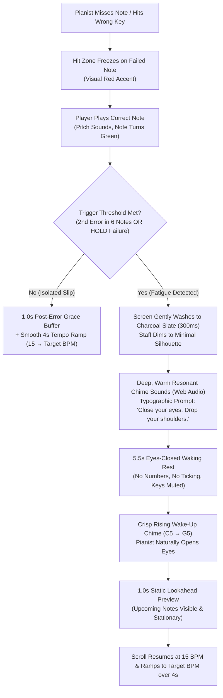

# Cognitive & UX Design Report: Mistake-Triggered Recovery Breaks

## Executive Summary & Core Premise

In *No-Nonsense Sight-Reading*, flow is sacred. When a pianist is reading accurately, their Dorsal Attention Network (DAN) is locked in, sensorimotor $\beta$-oscillations are entrained, and their Eye-Hand Span (EHS) is stable. **Interrupting an error-free player with arbitrary, scheduled 10-second timers is actively counterproductive and annoying.**

However, high-tempo sight-reading generates relentless neuromuscular demand. Under continuous scrolling, performance degrades within 2 to 5 minutes due to the accumulation of **Reactive Inhibition ($I_R$)**—acute micro-fatigue in the perceptual-motor loop (Hull, 1943; Parasuraman, 1979; Gupta & Rickard, 2022–2026; Das et al., PNAS 2025/2026). 

**Mistakes are the exact behavioral indicator that focus has slipped and $I_R$ has accumulated.**

When an error occurs, the pianist experiences immediate autonomic arousal (screen apnea, elevated heart rate) and antagonistic muscle co-contraction across the forearm flexors and upper trapezius (Yoshie et al., 2009). Forcing a tired pianist to immediately continue scrolling creates **compound error cascades** and encodes degraded motor patterns (*"practicing under acute fatigue severely impairs motor retention"*, Branscheidt et al., 2019).

### The Central UX Dilemma
How do we induce an **effective recovery break**—one where the user voluntarily **closes their eyes, drops their shoulders, and enters genuine waking rest**—without triggering the rage of a punitive software "lockout"? 

If an app presents a ticking numeric countdown (`8... 7... 6...`), the user's eyes stay locked on the screen, their pupils remain dilated, and their muscles stay rigid with irritation. To succeed, the break must feel like an **organic musical release**, not a penalty box.

---

## 1. Executive Recommendation: The "Acoustic Sanctuary" Post-Correction Protocol

The recommended design is the **Acoustic Sanctuary Post-Correction Protocol**. It triggers not on every trivial slip, but upon an **error cluster** or **HOLD-phase failure**, executing immediately **after** the user successfully identifies and plays the missed note.



### 1.1 Trigger Rule: Clustered Errors (Post-Correction)
The restorative break (6.5 seconds total) triggers **only after the player strikes the correct pitch of the missed note**, and only when micro-fatigue is verified:
1. **Cluster Threshold**: A second mistake occurs within 6 notes of a previous mistake (`notesHitSinceLastFailure < 6`).
2. **Correction Double-Fault**: Striking a wrong note twice while trying to correct a frozen error note.
3. **HOLD Phase Demotion**: Making any mistake during the 32-note HOLD sprint (where mental stakes and autonomic arousal are highest).

*Isolated slips* do not trigger the break; they receive a brief 1.0s Post-Error Slowing (PES) buffer followed by our standard 4-second gentle ramp from 15 BPM.

### 1.2 The Sensory Experience: Audio-Guided Waking Rest
1. **Visual Sanctuary (Screen Dimming)**:
   - As the correct note sounds, the canvas does not shake, flash, or pop up modal dialogues.
   - The entire screen smoothly transitions into a calming, deep charcoal slate (`#181a19`, 350ms cubic ease-out). The bright white background drops into low photopic luminance.
   - The grand staff dims to an unobtrusive 25% opacity silhouette.
2. **Absence of Numeric Countdowns**:
   - **Crucial Rule**: *There is no timer, no ticking progress bar, no circular countdown ring.*
   - If a counter is on screen, the human oculomotor system remains fixated on it, tracking each second, suppressing spontaneous eyeblinks (Nakano et al., 2013), and preventing Default Mode Network (DMN) wakeful recovery (Helton & Russell, 2015).
   - In place of a timer, a single line of warm, elegant text appears:
     > *"Close your eyes. Drop your shoulders."*
     > *(underneath in muted 11px gray: "A chime will wake the staff")*
3. **The Auditory Anchor**:
   - Simultaneous with the dimming, a rich, warm, organic acoustic chime (synthesized via Web Audio: a fundamental at $261.63\text{ Hz}$ [Middle C] with warm harmonic overtones decaying over 3.2 seconds) sounds.
   - Because the user knows an auditory cue will signal resumption, **the visual system is completely freed**. Closing the eyes becomes the natural, effortless reaction.
4. **Behavior on Impatient Key Mashing**:
   - If an agitated user mashes keys during the 5.5s pause, the app does **not** flash red, buzz, or extend the penalty.
   - Instead, the keypress triggers a gentle, dry **acoustic felt damper thud** (the sound of an unvoiced piano keybed strike). The screen remains unperturbed. The user instantly feels that the machine is calm, non-combative, and patiently waiting for them to let go.
5. **The Waking Chime & Lookahead Preview**:
   - At **Second 5.5**: A bright, pristine two-tone ascending chime sounds ($C_5 \rightarrow G_5$, pure fifth).
   - The user opens their eyes. The staff smoothly brightens back to full contrast over 1.0 second.
   - **Lookahead Buffer**: For that 1.0 second (Second 5.5 to 6.5), the upcoming notes on the right are **completely stationary**. This restores the pianist's **Eye-Hand Span (EHS)** (Furneaux & Land, 1999) before movement begins.
   - At **Second 6.5**: The stream begins rolling at 15.0 BPM (`V_MIN_START`), smoothly accelerating back to target tempo over 4.0 seconds.

---

## 2. Trigger Mechanics Analysis: When Should the Break Occur?

We evaluate three potential architectural moments to trigger recovery:

| Trigger Timing | Cognitive & Motor State | UX & Pedagogical Evaluation | Verdict |
| :--- | :--- | :--- | :--- |
| **Option A: Immediately on Error (Pre-Correction)** | High orienting response, medial frontal cortex error-related negativity (ERN), unresolved motor discrepancy. | **Highly Destructive.** Interrupting before correction creates an unresolved cognitive loop (Zeigarnik effect). The user is desperate to find the right key; forcing a pause here creates intense frustration and prevents motor reconciliation. | **Rejected** |
| **Option B: Single Mistake (Post-Correction)** | Error resolved; pitch heard; but could be an accidental mechanical slip (e.g., finger brushing adjacent key at 85 BPM). | **Overly Intrusive.** Forcing a 6–8 second pause on every isolated error interrupts flow states, lengthens levels unnecessarily, and annoys advanced players who simply mis-struck a single key. | **Rejected** (Reserved for 1.0s PES buffer only) |
| **Option C: Post-Correction on Error Clusters / Fatigue Threshold** | Motor discrepancy resolved; second error proves that $I_R$ has accumulated and attentional control is genuinely compromised. | **Optimal.** Resolves the motor loop first, validates that the failure is systemic rather than accidental, and intervenes precisely when continuing would encode bad motor habits. | **Recommended** |

### 2.1 Why Post-Correction is Non-Negotiable
In elite musical pedagogy (Duke, Simmons, & Cash, 2009), the gold-standard habit is: *stop on an error, isolate the correct pitch immediately, and hear the correct sound.*
- If the software freezes and blocks the player from striking the correct note, the brain remains in a high-arousal "error-monitoring" state. The anterior cingulate cortex (ACC) and posterior medial frontal cortex (pMFC) remain hyperactive, searching for sensory confirmation.
- When the player strikes the correct note, the auditory cortex receives the target pitch, the motor cortex registers the correct hand shape, and the error loop closes. 
- **Only after closure can sympathetic arousal drop and quiet wakeful rest begin.**

### 2.2 Mathematical Fatigue Detection Model
To prevent false-positive interruptions while catching genuine fatigue, the engine tracks error density:

$$\text{FatigueTrigger} = (\Delta_{\text{notes}} \le 6) \lor (\text{AttemptsOnCurrentNote} \ge 2) \lor (\text{Phase} = \text{HOLD})$$

Where:
- $\Delta_{\text{notes}}$ is `notesHitSinceLastFailure` (notes successfully cleared since the prior miss).
- If $\Delta_{\text{notes}} > 6$, the miss is treated as an isolated slip: target BPM drops by 10%, the staff pauses for $1.0\text{ s}$ to clear the Post-Error Slowing bottleneck (Danielmeier & Ullsperger, 2011), and resumes via standard 4s ramp-up.
- If $\Delta_{\text{notes}} \le 6$, the system recognizes **reactive inhibition / vigilance collapse**, triggering the **Acoustic Sanctuary**.

---

## 3. Catalog of UX Options Ranked & Compared

We explored five distinct UX mechanisms designed to induce genuine somatic relaxation and eyes-closed composure:

### Option 1 (Rank 1): The "Acoustic Sanctuary" (Audio-Guided Screen Dimming)
* **Mechanic**: Screen washes to warm dark slate (`#181a19`); staff dims to silhouette; warm Web Audio bell rings; no visible numbers; waking chime at second 5.5 followed by 1.0s static lookahead.
* **Why it works**: By deliberately withholding visual feedback, it removes the incentive to look at the screen. The auditory channel assumes responsibility for timekeeping, enabling total oculomotor and DMN disengagement.
* **Failure Modes**: User playing on mute (solved by fallback subtle breathing pulse if audio context is muted or unavailable).

### Option 2 (Rank 2): Somatic "Hands-Off / Key Release" Interlock
* **Mechanic**: The break requires physical key release. If the user continues resting heavy hands or tense fingers on the keyboard bed, the pause holds until all MIDI keys report `note-off` for at least 1.5 consecutive seconds.
* **Cognitive Rationale**: Pianists under stress develop isometric co-contraction of the *biceps brachii* and forearm flexors/extensors (Yoshie et al., 2009). Forcing physical detachment from the instrument forces muscle relaxation.
* **Drawback**: Can feel restrictive or "bossy" if the MIDI sensor calibration is sensitive or if the user is using computer keyboard mode.

### Option 3 (Rank 3): The "Autonomic Halo" (Guided Physiological Sigh)
* **Mechanic**: An elegant, ultra-minimal thin emerald halo ring ($2\text{ px}$) expands and contracts in the center of the staff over 6.5 seconds, guiding a cyclic **Physiological Sigh** (Balban et al., 2023):
  - *Seconds 0.0–2.0*: Inhale (ring expands).
  - *Seconds 2.0–2.8*: Sharp top-off inhale (ring expands slightly further).
  - *Seconds 2.8–6.5*: Slow, soothing oral exhale (ring contracts smoothly to zero).
* **Cognitive Rationale**: The double inhale followed by prolonged exhale activates pulmonary stretch receptors and arterial baroreceptors, engaging the vagus nerve and slowing heart rate within a single cycle.
* **Drawback**: Keeps the user's eyes glued to the screen to follow the visual ring, sacrificing the oculomotor reset of closed eyes.

### Option 4 (Rank 4): Progressive Cooldown Escalation
* **Mechanic**: Break length scales dynamically with consecutive error count:
  - Error 1: 0.8s micro-pause.
  - Error 2 (within 8 notes): 4.0s pause.
  - Error 3: 8.0s deep break with somatic copy (*"Drop your shoulders"*).
  - Error 4: 12.0s mandatory intermission.
* **Drawback**: Escalating timeouts strongly mimic punishment mechanics from competitive gaming ("respawn penalties"), inducing resentment rather than calm.

### Option 5 (Rank 5): Player-Initiated Resumption ("Rest Until Ready")
* **Mechanic**: On an error cluster, the screen pauses indefinitely. A prompt reads: *"Take a breath. When ready, press any key to roll."*
* **Cognitive Rationale**: Maximum player agency; zero feeling of lockout.
* **Drawback**: Impatient or frustrated users immediately tap a key within $200\text{ ms}$, completely defeating the biological necessity of clearing $I_R$. Human self-regulation under acute frustration is notoriously poor.

---

### UX Option Comparison Matrix

| Evaluation Criteria | Option 1: Acoustic Sanctuary (Recommended) | Option 2: Hands-Off Interlock | Option 3: Autonomic Halo (Physiological Sigh) | Option 4: Progressive Escalation | Option 5: Player-Initiated |
| :--- | :---: | :---: | :---: | :---: | :---: |
| **Effectiveness for Waking Rest & Eye Closure** | **Exceptional (5/5)**<br/>Audio cues explicitly liberate eyes; absence of timers eliminates staring. | **High (4/5)**<br/>Forces biomechanical release, but eyes may stay open. | **Moderate (3/5)**<br/>Excellent vagal reset, but requires constant visual tracking. | **Low (2/5)**<br/>Induces anger; user glares at long timer. | **Very Poor (1/5)**<br/>Users impulsively skip the break in <500ms. |
| **Frustration / Annoyance Risk** | **Very Low (5/5)**<br/>Framed as musical acoustics; non-punitive mute for early taps. | **Moderate (3/5)**<br/>Risk of feeling trapped if sensor glitches. | **Low (4/5)**<br/>Gentle and soothing, but slightly prescriptive. | **Severe (1/5)**<br/>Directly experienced as a punitive "timeout box". | **Zero (5/5)**<br/>Total player autonomy. |
| **Alignment with "No-Nonsense" Grayscale Aesthetic** | **Perfect (5/5)**<br/>Screen washes to charcoal; clean typography; no gamification. | **High (4/5)**<br/>Clean, but requires extra status copy. | **Moderate (3/5)**<br/>Animated ring borders on "wellness app" aesthetic. | **Moderate (3/5)**<br/>Numbers and timers clutter the clean UI. | **High (4/5)**<br/>Simple prompt, classic feel. |
| **Implementation Simplicity** | **High (4/5)**<br/>Simple CSS opacity transition + Web Audio Oscillator/Gain nodes. | **Moderate (2/5)**<br/>Complex state tracking for key-release across MIDI & QWERTY. | **High (4/5)**<br/>Simple SVG scale animation. | **High (4/5)**<br/>Simple integer math in SpeedController. | **Exceptional (5/5)**<br/>Trivial keydown event listener. |
| **OVERALL RANK** | **#1 (19/20)** | **#3 (13/20)** | **#2 (14/20)** | **#5 (10/20)** | **#4 (11/20)** |

---

## 4. Scientific Justification: How the Acoustic Sanctuary Restores the Brain & Body

The Acoustic Sanctuary directly operationalizes five major findings from cognitive neuroscience and motor control:

```
+---------------------------------------------------------------------------------------------------+
|                                  THE 6.5-SECOND RECOVERY TIMELINE                                 |
+---------------------------------------------------------------------------------------------------+
|  0.0s - 0.3s   | Screen washes to dark slate; correct note rings out. Post-Error Slowing resolves.|
|  0.3s - 3.5s   | Fundamental 261.6Hz chime decays. Eyes close. Dorsal Attention Network deactivates.|
|  3.5s - 5.5s   | Default Mode Network activates; wakeful neural replay clears Reactive Inhibition.|
|  5.5s - 6.5s   | Rising Chime (C5 -> G5) sounds; eyes open; 1.0s static lookahead restores EHS.   |
|  6.5s +        | Smooth scroll begins at 15 BPM; 4.0s recovery ramp safely restores tempo.         |
+---------------------------------------------------------------------------------------------------+
```

1. **Dissipation of Reactive Inhibition ($I_R$) vs. Memory Consolidation**:
   - As established by Gupta & Rickard (2022–2026) and Das et al. (PNAS, 2025/2026), 5–10 second rest intervals do *not* consolidate sequence memory (the "95% consolidation" claim was an artifact of comparing fatigued trial ends to fresh trial starts). 
   - Instead, pauses allow the rapid biological dissipation of Hull's $I_R$—clearing central and peripheral micro-fatigue. A 5.5s pause is mathematically sufficient to restore keystroke velocity and temporal precision.
2. **Preventing Degraded Motor Learning**:
   - Branscheidt et al. (2019, *eLife*) proved that continuing deliberate motor practice under acute fatigue degrades long-term motor skill retention. Pushing through an error cluster ingrains sloppy finger targeting. The break enforces quality over frantic repetition.
3. **DAN-to-DMN Switching via Oculomotor Closure**:
   - Nakano et al. (2013, *PNAS*) demonstrated that eyeblinks and eye closures are active neurobiological circuit breakers: eye closure suppresses the Dorsal Attention Network (DAN) and instantaneously activates the Default Mode Network (DMN), resetting the locus coeruleus-norepinephrine (LC-NE) vigilance system.
4. **Uncoupling Antagonistic Muscle Co-Contraction**:
   - Yoshie et al. (2009) showed that tempo stress triggers involuntary co-contraction between opposing forearm muscle groups and elevates the upper trapezius. 
   - The brief audio prompt (*"Close your eyes. Drop your shoulders."*) functions as an explicit somatic release cue, instantly dropping joint stiffness and restoring fluid ballistic finger kinematics.
5. **Restoring the Eye-Hand Span (EHS)**:
   - Furneaux & Land (1999) proved that skilled sight-readers read 1.0 second ahead of their hands. When an error occurs, this buffer collapses to zero.
   - The **1.0-second static lookahead preview** at the end of the break allows the gaze to leap forward to note $n+1$ before the scroll motor restarts.

---

## 5. Technical Specification & Implementation Blueprint

### 5.1 State Machine Integration (`src/engine/engine.ts`)
Add a new substate to the playback engine:
```typescript
export type PlaybackSubstate = 
  | 'NORMAL' 
  | 'WAITING_FOR_CORRECTION' 
  | 'ACOUSTIC_RECOVERY_PAUSE'; // New substate

export interface EngineSnapshot {
  // Existing fields...
  substate: PlaybackSubstate;
  recoveryRemainingMs: number; // 0 to 6500 ms
}
```

### 5.2 Transition Logic in `handleNoteInput()`
```typescript
if (this.substate === 'WAITING_FOR_CORRECTION') {
  if (matchesTarget(input, this.failedNote.target)) {
    const target = this.failedNote.target;
    this.failedNote.state = 'hit';
    this.failedNote.stateTimeMs = 0;
    this.lastPrecedingTarget = target;
    this.failedNote = null;

    // Check fatigue cluster condition:
    const isErrorCluster = 
      this.speedController.notesHitSinceLastFailure <= 6 || 
      this.phase === 'HOLD';

    if (isErrorCluster) {
      this.substate = 'ACOUSTIC_RECOVERY_PAUSE';
      this.recoveryRemainingMs = 6500; // 5.5s rest + 1.0s lookahead
      this.audioSynthesizer.playRestSanctuaryChime(); // Warm 261.6Hz bell
    } else {
      this.substate = 'NORMAL';
      this.speedController.startRecoveryRamp(); // Standard 1.0s grace + 4s ramp
    }
    return { outcome: 'correction_complete', matchedTarget: target };
  }
}
```

### 5.3 Web Audio Chime Synthesis (Zero External Audio Assets)
The audio cues should be generated purely via the existing Web Audio API context, ensuring zero asset download latency:
1. **Rest Sanctuary Chime ($t = 0.0\text{ s}$)**:
   - Sine oscillator at $261.63\text{ Hz}$ ($C_4$) + subtle overtone at $523.25\text{ Hz}$ ($C_5$, gain $-14\text{ dB}$).
   - Exponential gain decay from $0.4$ to $0.001$ over $3.2\text{ seconds}$. Warm, low-pass filter at $800\text{ Hz}$ to avoid piercing highs.
2. **Wake-Up Chime ($t = 5.5\text{ s}$)**:
   - Ascending two-tone interval: $523.25\text{ Hz}$ ($C_5$, $120\text{ ms}$) $\rightarrow$ $783.99\text{ Hz}$ ($G_5$, $400\text{ ms}$ decay).
   - Crisp, clear, gentle prompt signaling that the lookahead window is live.
3. **Muted Keybed Damper ($t \in [0, 5.5\text{ s}]$ during impatient taps)**:
   - Bandpass-filtered burst of pink noise ($150\text{ Hz}$, $Q=2.0$) decaying in $60\text{ ms}$. Sounds exactly like a mechanical felt piano hammer touching an unplayed string.

### 5.4 UI / CSS Aesthetics (`src/components/StaffCanvas.tsx`)
In keeping with the "No-Nonsense" minimalist design philosophy:
- When `substate === 'ACOUSTIC_RECOVERY_PAUSE'`:
  - Canvas overlay transitions to `background: rgba(24, 26, 25, 0.88)` with `transition: background 350ms cubic-bezier(0.16, 1, 0.3, 1)`.
  - The staff lines and notes soften to `opacity: 0.20`.
  - Centered typography rendered in clean sans-serif (Inter / system font):
    ```html
    <div className="recovery-sanctuary-container">
      <p className="recovery-prompt-main">Close your eyes. Drop your shoulders.</p>
      <p className="recovery-prompt-sub">A chime will wake the staff.</p>
    </div>
    ```
  - **No numbers. No progress circle. Pure, respectful stillness.**

---

## 6. Summary: Why This Solves the User's Problem

1. **Protects Flow**: Unbroken playing is never interrupted. High performers can practice for minutes without seeing a pause.
2. **Targets the True Culprit**: Breaks happen only when micro-fatigue ($I_R$) is behaviorally proven by error clusters or HOLD-phase breakdown.
3. **Eliminates Lockout Resentment**: By eliminating visible timers and providing an auditory anchor, the break is experienced as a luxurious, musical reset rather than a penalizing timer.
4. **Maximizes Deliberate Practice Quality**: The user returns to the piano with loose shoulders, normal breathing, an aligned Eye-Hand Span, and a refreshed attentional network—preventing sloppy habits and ensuring rapid sight-reading mastery.
